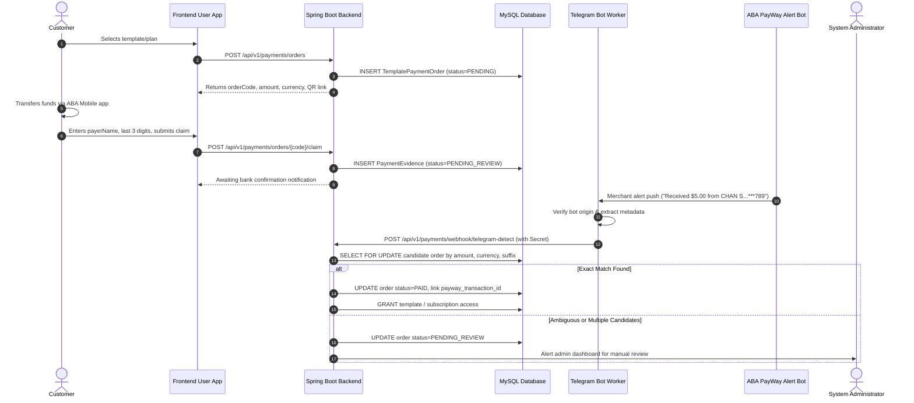

# ABA PayWay & Telegram Reconciliation Technical Flow

## 1. Sequence Diagram

## 2. Ingestion Parsing Rules

The Telegram worker extracts:
- `detected_amount`: Parsed decimal value (e.g. `5.00`).
- `detected_currency`: Currency identifier (`USD` or `KHR`).
- `payer_account_last3`: Last 3 digits extracted from account mask (`***123`).
- `payer_name`: Payer name text.
- `payway_transaction_id`: Bank transaction code or reference ID.
- `merchant_message_at`: Timestamp of bank alert delivery.

