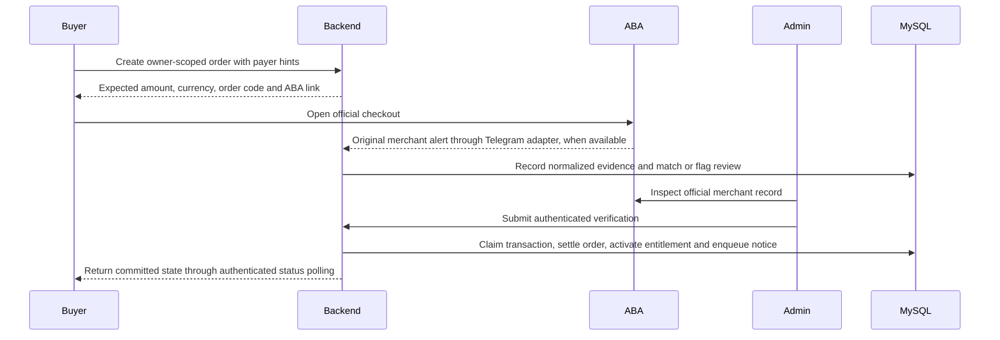
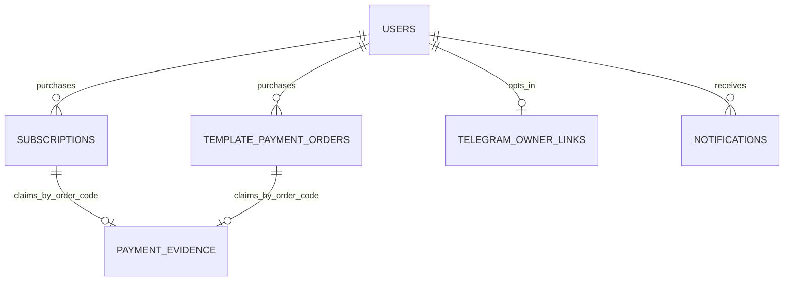

# Koupreng V4 payment operations

## ស្ថានភាពនៃការអនុវត្ត

The Spring Boot payment module owns prices, order lifecycles, reconciliation and entitlement activation. The existing React applications and MySQL instance remain the entry points. The existing Python Telegram worker acts as the PayWay delivery adapter. Owner-facing Telegram settings and the User Bot webhook live in Spring Boot.

| Area | Status | Evidence and limits |
| --- | --- | --- |
| Fixed subscription checkout | COMPLETED for existing approved plan links | Price, currency, duration and benefits are captured by the backend. The buyer continues in ABA and React status polling reads the owner's order endpoint. |
| Requested merchant link | PARTIAL | Playwright opened the ABA page on 26 November 2026 and verified the title `KOEURNG VIREAK`. The checkout rendered a language selector and ABA footer. Amount, currency, payment methods, remarks and unique checkout sessions remained unverified. The existing amount-verified route remains active. |
| Dynamic KHQR and automatic bank verification | BLOCKED for the requested merchant link | The official ABA APIs require authorized merchant credentials. Merchant enrollment, agreement terms and API access for this account need confirmation from ABA. |
| Official bank record reconciliation | COMPLETED in code | Admin verifies the actual bank record and enters the merchant, currency, amount, transaction ID, matching notes and successful/unreversed attestation. Detected and late orders can be reconciled through this path. |
| User Bot and merchant group | PARTIAL | Windows Computer Use identified Telegram Desktop, the pinned merchant group and a verified BotFather chat. Telegram Bot API `getMe`, `getWebhookInfo`, `getChat` and `getChatMember` confirmed one existing bot with a configured webhook and membership in the intended group. |
| Independent Admin Bot and genuine PayWay delivery | BLOCKED live | A separate Admin Bot token, its webhook secret and a numeric allowlisted PayWay sender ID are required. Live group permissions and the current webhook were left in their observed configuration. |
| Test mode | PARTIAL | Unit, application and isolated MySQL fixture tests exercise payment and linking workflows. A production-accessible simulator is absent. |

### Provider capabilities

| Capability | Existing plan fixed links | Requested merchant page | Official PayWay API |
| --- | --- | --- | --- |
| Amount and currency | Server-enforced catalog price and USD per fixed link | Unverified | Available under an authorized merchant integration |
| Order reference / remark | Internal Koupreng reference. Use a remark only if shown by ABA. | Unverified | Transaction uses a provider-supported merchant transaction reference |
| Dynamic QR / app deep link | Existing hosted bank flow | Unverified | Depends on endpoint and merchant enrollment |
| Independent verification | Administrator uses official merchant records | Administrator uses official merchant records | Signed Check Transaction request with merchant ID and ABA credentials |
| Merchant agreement and fees | Existing configured flow | Needs merchant confirmation | Confirm entitlement and terms directly with ABA |

Source material: [ABA Payment Link](https://developer.payway.com.kh/folder-3158157), [ABA Check transaction](https://developer.payway.com.kh/check-transaction-14530826e0), [Bakong](https://bakong.nbc.gov.kh/), [KHQRPay payments](https://khqrpay.dev/docs/payments), [checkout](https://khqrpay.dev/docs/checkout), [webhooks](https://khqrpay.dev/docs/webhooks), [OpenAPI](https://khqrpay.dev/openapi.json), and [Telegram Bot-to-Bot](https://core.telegram.org/api/bots/bot-to-bot).

KHQRPay served as a design reference for provider capabilities, expiring orders, evidence-driven status, signed deliveries and late reconciliation. Koupreng uses its existing backend, database and Telegram integration.

## Verification and settlement

`PENDING` can enter review, expire, or be verified through the administrator workflow. A Telegram match writes `MATCHED_UNVERIFIED` to the separate evidence row and moves the order to review. A conflicting or ambiguous notification remains in review. `EXPIRED` remains eligible for documented manual reconciliation. The verified ABA API path remains available to its existing authorized template integration. Admin verification stamps method, merchant, reviewer, verification timestamp and reconciliation notes on the transaction evidence. The database transaction claims a unique ABA transaction across both template and subscription orders, updates the order and entitlements, and stores outbox records atomically. Failed notification delivery leaves the financial transaction committed.

`payment_evidence.transaction_id` is unique and `(chat_id, message_id)` deduplicates source messages. The normalizer extracts exact currency and amount, payer display name and masked account suffix, transaction ID, and optional approval code, merchant message time and remark. A conflicting explicit order reference prevents a weaker fallback. A unique amount and suffix alone does not settle an order. An Admin can reconcile from official merchant records when no Telegram message is available. A screenshot or message alone cannot substitute for inspecting those records.

### Security and privacy

- Route administrative settlement through JWT-backed ADMIN authorization. The internal worker secret authorizes evidence ingestion. Payer claims carry no settlement authority.
- Configure numeric chat and sender IDs. The worker checks original message metadata and rejects forwards and messages from unexpected senders. Messages are stored in normalized form without full bank account numbers.
- Keep USD and KHR separate. KHR uses whole riel and USD accepts cent precision. Admin notes should name the evidence and describe the match without including account numbers or customer documents.
- User Bot settings require an authenticated owner. A five-minute cryptographic challenge is stored as a hash, and a private chat consumes it once. Webhook updates are deduplicated by bot ID and update ID. Disconnect removes the link and makes outstanding deliveries ineligible when the worker claims them.
- Operator risks include a compromised admin or bot token, duplicate or delayed events, same-amount orders, provider downtime, and a missed acknowledgement after a Telegram send. Admin reachability, secret separation and auditable record matching mitigate these risks. Telegram delivery uses bounded retries and may repeat if the provider sends successfully but the worker loses its acknowledgement.

## Telegram setup and automation

The observed environment has the legacy User Bot token, username, webhook secret, internal payment secret and merchant group configuration. The independent Admin Bot token, both role-specific webhook secrets and numeric PayWay sender ID need action. Use ignored local environment files or the deployment secret store. The project and worker `.env` files are ignored by Git. The frontend receives public bot identifiers only.

1. In verified `@BotFather`, use `/mybots` to find an existing second bot. If no Admin Bot exists, obtain the owner's explicit approval before creating the identity. Check both using `getMe` from a secure local session. Reuse `TELEGRAM_BOT_TOKEN` and `TELEGRAM_BOT_USERNAME` for the User Bot. Add `TELEGRAM_ADMIN_BOT_TOKEN` and two independent webhook secrets.
2. Prepare the User Bot endpoint `/api/v1/telegram/user/webhook` and the existing adapter endpoint `/telegram/webhook` for the Admin Bot. Register each using the same secret supplied in its environment. Replacing the existing live webhook requires explicit approval.
3. In the intended merchant group, confirm the genuine numeric bot sender against Telegram update metadata. Check that the intended Admin Bot has Bot-to-Bot Communication Mode, appropriate administrator access and Group Privacy Mode disabled. Ask for explicit approval before changing live group access. Confirm delivery of an ordinary original PayWay notification, then validate exact currency, amount and transaction ID in the reconciliation workflow. The User Bot's existing membership and a matching group title do not prove that Telegram will deliver ordinary PayWay messages.
4. In the application, go to **Notifications → Telegram**, open the five-minute link and press **Start** in the private chat. Return to the app to confirm the connected state. Disconnect using the UI or `/stop`.

| Requested automation | Delivery |
| --- | --- |
| Invitation publication | Owner alert after successful publish using the transactional outbox |
| RSVP | Owner alert on create or a status/party-size change |
| Payment updates | Owner pending, review, matched and verified activation notices. Admin worker continues receiving detection and settlement updates. |
| Countdown | Published upcoming events at seven, three and one day before the date in the event time zone |
| Guest reminders | Not implemented. Guest-specific consent and authenticated association require a separate verified flow before enabling. |
| Daily RSVP report | Summary for upcoming published events, configurable installation-wide from `08:00` by default with `TELEGRAM_DAILY_RSVP_TIME` and `TELEGRAM_DAILY_RSVP_ENABLED` |
| Telegram commands | User commands open authenticated Koupreng screens. Admin commands direct authorized operators to the dashboard or request detection of a replied-to original alert. |

## Rollout, monitoring and rollback

1. Use a database backup and stage the release against an isolated MySQL schema. Run the Java payment, subscription, Telegram and architecture suites with the repository's `RUN_FLYWAY_INTEGRATION` settings. Run the frontend builds and checkout browser tests and the Python adapter tests.
2. Review migration `V52` for verification metadata, `V53` for owner links and `V54` for webhook-update deduplication. Run Flyway forward and keep existing migration checksums intact. Deploy the backend and both frontend builds together so the administrator form supplies the required bank record.
3. Keep privileged settings unset until the two roles are verified. Use an authorized test bot to verify linking, opt-out, scheduled reports and webhook errors. Require an independently approved live test before conducting any financial transaction.
4. Monitor unapplied migrations, the MySQL and worker health checks, old review orders, payment miss/match and transaction reuse outcomes, and notifications with exhausted delivery attempts. Review unexpected discrepancies through official merchant records.
5. If rolling back the app, retain the additive migrations and prevent restoration of the retired worker-only confirmation route at the proxy. Keep legacy automatic Telegram confirmation disabled. Restore a webhook only with owner authorization. Avoid restoring an older database snapshot over settled live payments.
