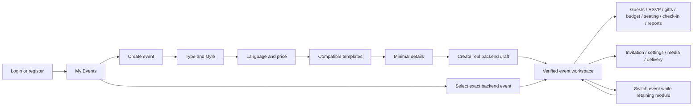
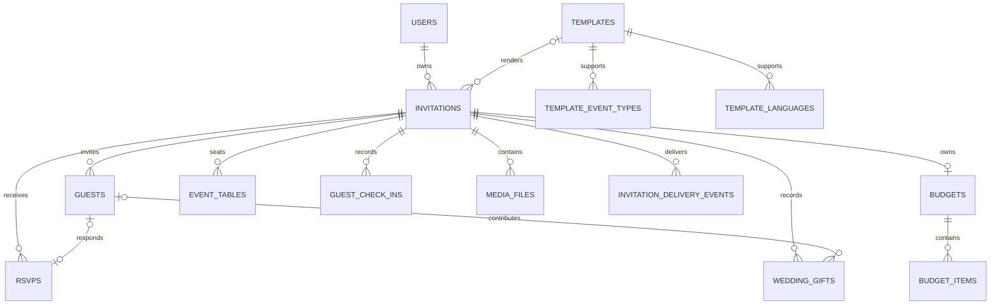

# Event-first workspaces

Implemented on `feature/event-first-workspaces`, starting at `62eb20f7`. See [discovery](../audit/event-first-discovery.md) for the verified before-state and [verification](../qa/event-first-verification.md) for execution evidence. This change has not been deployed or pushed.

## Identity and ownership

`UserInvitation` remains the canonical managed event. Frontend `eventId` maps directly to the numeric backend `invitations.invitation_id`; APIs retain the name `invitationId`. A local draft ID, public slug, template ID and backend invitation ID are distinct identifiers. The legacy `events` aggregate and ADMIN-only `/api/v1/events` API remain separate and are not used to create host workspaces.

`EventWorkspace` first fetches the exact owner-protected invitation and owner event list. A denied, invalid or missing invitation mounts no management module. Its child boundary is keyed by authenticated user and backend event ID. Changing either unmounts the previous module, including its async state and mutation closures. Effect cancellation/generation guards prevent obsolete results from committing. This avoids previous-event content during rapid switching or slow responses.

Protected operations continue to authorize the owner in backend application services and scope child queries by invitation ID. A route parameter and browser storage never grant authority. Guests, gifts, budget, media, delivery and RSVP share `InvitationService` ownership checks. Seating, check-in and reporting retain their existing explicitly authorized ADMIN exception.

`EventAccessPolicy` defines event permissions and an owner-only extension point. It grants no collaborator roles. Organization membership allows existing organization association operations; it does not grant access to another owner's invitations. Adding collaborators later requires specific permission checks throughout all modules before enabling grants.

## Route map

| Scope | Routes | Behavior |
|---|---|---|
| Account | `/app/events`, `/app/events/new` | My Events and six-step onboarding |
| Account | `/app/profile`, `/app/change-password`, `/app/packages`, `/app/payments`, `/app/payments/:orderCode`, `/app/notifications`, `/app/organizations`, `/app/organizations/:organizationId`, `/app/templates/paid` | Existing account features |
| Event | `/app/events/:eventId` | Existing dashboard, exact event only |
| Event | `.../invitation`, `.../settings`, `.../preview` | Existing wedding editor or event-aware details; verified preview |
| Event | `.../guests`, `.../rsvp`, `.../gifts`, `.../budget` | Existing server-backed modules |
| Event | `.../seating`, `.../check-in`, `.../reports` | Existing event operations and report |
| Event | `.../delivery`, `.../media`, `.../qr`, `.../wishes`, `.../assistant` | Existing supporting modules |
| Public | `/w/:slug`, `/i/:slug`, template demo/preview routes | Preserved public entry points and capability protections |

The HostNav keeps the existing header, profile, language and mobile presentation, with account-level navigation. The event header supplies a separate module navigation and switcher. The switcher lists accessible backend events and preserves recognized modules; unrecognized suffixes fall back to the selected overview. All currently listed modules have implementations for the canonical event aggregate; backend feature entitlements still apply.

Explicit legacy invitation links redirect to the same event/module, including reports. `/dashboard?id=101` redirects to `/app/events/101`. Ambiguous `/dashboard/guests`, `/dashboard/gifts`, `/dashboard/expenses`, `/reports` and related links redirect to `/app/events?module=...`; choosing a card then opens that module for the selected event. No first-event fallback occurs. Account `/dashboard/...` aliases preserve concrete order/organization parameters. Numeric legacy builder links redirect to the verified invitation editor; existing local draft edit and preview URLs remain usable.

## RBAC matrix

| Action | Anonymous | USER | STAFF | ADMIN |
|---|---|---|---|---|
| Active catalog, recommendations, public template preview | Yes | Yes | Yes | Yes |
| Public invitation/RSVP | Existing publication, visibility, password and guest-token policy | Same | Same | Same |
| Manage owned canonical event | No | Owner only | Owner only | Owner only |
| Manage another owner's invitation/guests/gifts/budget | No | No | No | No through owner workspace APIs |
| Existing administrative moderation APIs | No | No | No | Existing explicit ADMIN policy |
| Existing administrative seating/check-in/report access | No | No | No | Existing owner-or-ADMIN policy |
| Legacy `/api/v1/events`, admin UI, operational endpoints | No | No | No | Yes under existing policies |
| Buy premium access | No | Trusted purchase/subscription | Same | Existing purchase policy |
| Grant event collaborators | No | Not implemented | Not implemented | Not implemented |

Both JWT conversion and password user-details construction now preserve `ROLE_STAFF`. Disabled-account and token-version validation, cookie CSRF and payment reconciliation are unchanged. The admin application rejects STAFF sessions. No new platform support permissions were invented.

## Authentication and session behavior

Normal password, registration and supported social-login flows land at `/app/events`. `safeAuthRedirect` permits supported application/editor/checkout deep links while rejecting external origins, backslashes, control characters, encoded separators, auth loops and other-app destinations. The target route and backend still enforce access. Google and Telegram continue to use their existing verified provider flows.

The existing configured HttpOnly-cookie or bearer-storage mode remains authoritative. Cookie bootstrap retains server validation and race protection. Cookie sessions revalidate when the tab becomes visible; bearer sessions expire on a timer. Logout revokes the original backend session, clears authentication and selected-event state, and broadcasts a token-free logout marker to other tabs. Saved event/draft records are retained. No refresh-token API has been invented.

Existing development first-user-admin bootstrap remains configurable. Production already defaults it off; ordinary-user HTTP tests explicitly disable it. This change does not alter deployment settings or credentials.

## My Events lifecycle

The existing cards and local/server merging remain, with search, status filtering, sorting and client pagination (12 cards). Backend records and local drafts stay visible independently. A backend-backed Manage action uses `backendInvitationId` when present; a local-only card opens its editor. Draft cards expose Continue Editing and Preview.

Loading and recoverable errors are visible. Server deletion must succeed before any local copy is deleted. A synchronized draft whose server record is missing is retained with an explanation. Synchronization failures retain the draft and error. Legacy local synchronization persists a UUID create key before the network request and reuses it on retry; a manual failure is not immediately retried by automatic synchronization. No unsynchronized records are silently discarded.

Backend lifecycle remains `DRAFT`, `PUBLISHED`, `UNPUBLISHED`, `ARCHIVED`; this change does not add an archive action. Publish/unpublish use existing readiness and entitlement services. The settings form exposes existing PUBLIC, PRIVATE and PASSWORD_PROTECTED visibility; new wizard drafts start PRIVATE. Complete the address and choose visibility before publishing.

## Onboarding and event-aware editing

1. Select WEDDING, ENGAGEMENT, BIRTHDAY, ANNIVERSARY, CORPORATE or OTHER using Khmer-first labels.
2. Choose a style from actual compatible catalog categories, or all available styles.
3. Choose KH, EN or BOTH.
4. Choose ALL, FREE or PREMIUM.
5. Preview/select an active compatible recommendation. An empty state explains missing compatibility; style alternatives retain type/language/price eligibility.
6. Enter title, appropriate participant/host names, date, time and venue. Address is optional at creation. Save a real backend draft and open its returned ID.

Guests, media, gifts, budget and detailed schedule are optional during initial setup. Wedding fields identify bride/groom; engagement/anniversary identify two participants; birthday identifies a celebrant; corporate identifies an organization/host. The existing wedding editor is preserved. Other event types and the new neutral template use the shared configuration-based details form. The neutral editor additionally supports an optional message/description, language, contact and schedule, stored in the existing `contentJson` contract. Its public renderer uses those saved fields without wedding labels or demonstration participants.

Wizard input and its request key are stored per account in this tab's session storage, with an in-memory fallback when browser storage is unavailable. Save is guarded against double submission. Network failure retains entered values; retry uses the same create key. Refresh can resume stored inputs without forcing onboarding after future logins. No mock invitation is substituted for backend persistence.

## Catalog compatibility and deterministic ranking

Visual `TemplateCategory` remains distinct from event type. V37 adds relational sets:

Backfill is deliberately limited to inspected Silk Heritage, Khmer Celestial and Royal Khmer renderer codes: WEDDING, KH/EN/BOTH. Unknown/custom templates retain empty mappings and remain in the existing catalog but do not enter recommendations. Their compatibility must be reviewed before a future forward migration adds mappings. V37 also seeds `event-essential`, a new neutral renderer with all six supported event types and three language modes. Existing template IDs, categories and invitations are not repointed.

Eligibility requires ACTIVE status, supported event type, supported language and the requested price class. A positive catalog price counts as paid even if the premium flag is false. Style is the only ranking input: an exact match (or no preference) scores 100; compatible style alternatives score 0. Ties sort by numeric template ID. This normalizes the sole available preference without inventing popularity or usage statistics. All compatible alternatives remain browseable. There is no LLM dependency.

Collections are loaded together for active-catalog queries. Recommendation responses contain public metadata only; no user/event data is cached in the public catalog. Backend invitation creation/update validates declared compatibility and active-template selection, then independently enforces paid entitlement. Historical templates with no reviewed mapping remain editable through their existing flow; they are not automatically classified as supporting every event type.

## API and database changes

| Contract | Change |
|---|---|
| `GET /api/v1/templates` and public template detail | Add `supportedEventTypes` and `supportedLanguages` |
| `GET /api/v1/templates/recommendations` | New deterministic filtered catalog endpoint |
| Recommendation parameters | Required `eventType`; optional `style`; `language=KH`; `pricePreference=ALL`; invalid enum values return 400 |
| Recommendation response | Existing `ApiResponse` envelope containing `{template, score, styleMatch}` records |
| `POST /api/v1/invitations` | Optional UUID `clientRequestId`; existing clients remain compatible |
| Create retry | Same owner/key returns the original draft; deleted original returns 409; a new key creates a distinct event |
| Event/module APIs | Existing `/api/v1/invitations/{invitationId}/...` contracts remain in use |
| Contract artifacts | Runtime-generated `packages/api-contracts/openapi.yaml` and admin monitor manifest updated |

V37 adds `template_event_types`, `template_languages`, foreign keys, unique composite primary keys, allowed-value checks and a nullable immutable `invitations.client_request_id`. The unique `(user_id, client_request_id)` index and a transactional owner-row lock serialize retryable creation across instances. Owner creation limits still run for new records. Existing rows have NULL request keys. No financial columns, price policies, payment secrets or historical migrations change; USD and KHR remain separate.

## Release, migration and rollback

This is a local feature branch, not a production release. Before deployment, run fresh and representative-upgrade Flyway tests against disposable MySQL 8, verify Hibernate mappings, and rehearse backup/restore. H2 persistence tests are not MySQL migration proof. Existing environment-gated MySQL tests were skipped locally. Review external provider, proxy/cookie and payment smoke evidence in staging.

Apply V37 through normal Flyway startup before running the new backend. Deploy the matching frontend to make the neutral template and new API usable together. No production containers, DNS, credentials or payment settings were changed. Compatibility metadata for future admin-created templates requires an explicit reviewed migration; this release has no admin compatibility editor.

Rollback must preserve data and Flyway history. Leave V37's additive schema and draft keys in place. Roll back onboarding/navigation selectively while retaining the neutral public renderer and its adapter support for any already-created `event-essential` invitations. Do not switch those records to a wedding renderer or delete their data. A complete application rollback to a version without that renderer requires an explicit compatibility plan for existing neutral public links first. If the new catalog entry must be disabled, use a reviewed forward migration to mark it inactive; do not rewrite V37 or undo migration history. Restore backups only through the approved operational process.

## Deliberate limits

- Collaborator invitations, event memberships and per-collaborator capabilities are deferred. Only the owner policy extension point is implemented.
- Local/offline draft records are retained, but protected server modules require a synchronized backend event.
- Event list pagination currently paginates the fetched owner list in the client; server pagination is not introduced without a contract change.
- Only reviewed templates participate in recommendations; the neutral template supplies other event types. Full bespoke designs for every non-wedding event type are not claimed.
- Live Google/Telegram/ABA/SMTP/Cloudinary success and MySQL migration execution remain environment-dependent release gates. Browser fixture tests verify UI behavior; the HTTP/H2 tests verify real backend behavior, not external providers.
