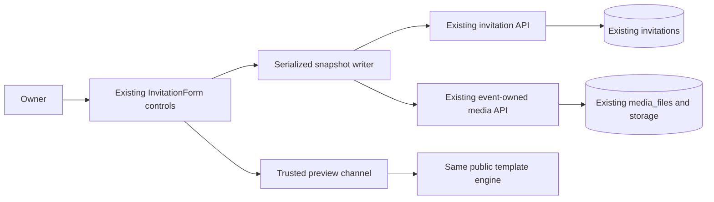

# Invitation Studio and personalized tickets

Implemented on `feature/invitation-studio-tickets`, starting from local `715b85ef`. Discovery: [source audit](../audit/studio-ticket-discovery.md). Verification and release gates: [QA report](../qa/studio-ticket-verification.md).

## Editor architecture

The canonical route remains `/app/events/:eventId/invitation`. Numeric event IDs load the existing invitation and its owned media. Explicit legacy drafts retain their existing compatibility path. No event or guest identity is created by the studio shell or by opening a ticket.

`InvitationForm` retains its existing controls and template-specific `templateFormFlowConfig`. A section navigator selects those controls; the desktop workspace places it beside the controls and live preview. Under 1024px the section selector and Edit/Preview controls replace the desktop arrangement. The real template iframe keeps its origin/session checked preview channel, cover/full state, mobile/desktop width, zoom, reset and fullscreen controls.



The writer debounces synchronized event edits by 1500ms. One request sequence runs at a time; its completion acknowledges only the submitted snapshot. Subsequent edits remain dirty. Failed saves require explicit retry; offline state never means saved. Explicit saves upload pending media, stay in the editor and report server failures. Initial synchronization state is based on the loaded event, not a new browser-only write. History retains at most 25 snapshots. Undo/redo and confirmed reset operate on editor state; pending file handles are discarded on restore while inline image previews remain recoverable through the upload path.

Before-unload warnings cover reload/closing. BrowserRouter navigation adapters cover route links and imperative event switching. The shared history guard registers before BrowserRouter, preventing a rejected back/forward transition from unmounting the editor; it adds no history entries. The ticket designer also guards unsaved navigation. Publishing is a separate action that first waits for successful saving, then requires a `PUBLISHED` backend response.

## Customization contract and compatibility

Existing invitation `designJson` and `contentJson` remain authoritative. The save whitelist now includes `fontKhmer`, `fontLatin`, `elementFonts`, `studioStyle`, background color and section order. `studioStyle` is optional and contains five color roles (`primary`, `accent`, `text`, `background`, `border`), approved body font, message size/alignment and portrait focal point. Color rendering accepts only six-digit hex values; enum-like rendering values are allowlisted.

Khmer Celestial exposes six curated palettes, five individual color roles, bundled heading/body fonts, three message sizes, alignment and portrait positioning. These controls map to its own CSS variables and retain the original layout. Other renderers retain their existing palettes and structure; the editor does not offer the new appearance panel for unverified renderers. Existing optional sections follow each template's configuration. Fixed-order wedding renderers are not given a nonfunctional section-reorder control. Schedule and gallery item ordering are editable and persisted. Schedule dates/descriptions survive normalization. Saved empty collections stay empty on reload.

The existing family, couple, cover/background, invitation/closing/apology, music picker/player, map, gallery, story, party, FAQ, gift KHQR and language controls remain. Formal wording presets support Khmer/English and require confirmation before replacing text. These edit the selected invitation wording; this change does not introduce a second translation document model. Event title, couple names and venue are prefilled from real backend fields before customization JSON exists. Explicitly cleared preview fields no longer substitute a demonstration name, message or date.

Uploads reuse `MediaService` validation and ownership. Actual cover files use the cover endpoint. Backgrounds and other images use gallery uploads, preserving the canonical cover association. Nested story, party, map, gift and brand images are resolved to permanent URLs before final JSON persistence. Duplicate inline references upload once. Transient `data:`/`blob:` strings are stripped from persisted JSON and local draft backups. JPEG/PNG/WebP images are limited to 5 MB on the client; backend signature/type/quota enforcement remains authoritative. No new storage provider or arbitrary ticket image URL input is introduced.

## Ticket data model

`invitation_ticket_designs` has one row per existing invitation. `invitation_id` is both its primary key and a foreign key to `invitations`; JPA uses `@MapsId`. Its fields are bounded design JSON, an optimistic version, and creation/update timestamps. There is no guest table or independent ticket identifier. Personalization reads the existing guest and seating assignment each time.

V38 creates the table. Forward-only V39 changes its foreign key to `ON DELETE CASCADE`, preserving the existing physical event-delete operation. JPA declares the same cascade behavior for H2 integration verification. No V1–V37 migration is changed. V38 remains unchanged from its first implementation commit; the cleanup correction is a separate increment.

The design DTO validates:

| Field | Contract |
| --- | --- |
| `version` | Nonnegative revision; absent design is revision 0; first stored design is API revision 1 |
| `layout` | `GOLD`, `MINIMAL`, `FLORAL`, `IVORY` |
| `accent` | Six-digit hex color |
| `font` | `MOUL`, `KANTUMRUY`, `CORMORANT` |
| `frame` | `DOUBLE`, `SINGLE`, `NONE` |
| `header`, `footer` | Plain text, maximum 100/200 characters |
| `backgroundMediaId`, `coverMediaId` | Optional positive IDs of validated images belonging to this event |
| Display flags | Guest group, table/seat, guest count |

`TicketDesignResponse` contains schema version 1, the design and resolved owned image URLs. Deleting selected media falls back to the layout. Supplying foreign or non-image media on save is rejected. A stale revision or database concurrency conflict returns HTTP 409 and requires reloading rather than overwriting another edit.

`TicketResponse` contains kind (`GENERAL` or `GUEST`), event title/names/date/time/venue, optional guest display name/group/table/seat/count, the existing invitation URL/QR payload/QR image, and appearance. It omits guest phone, email, notes and unrelated event data. Configured display flags control optional guest fields. Assigned table/seat information takes precedence over the guest's legacy table field.

## APIs

All owner endpoints authenticate and enforce exact event ownership and `QR_INVITATIONS`. Public retrieval enforces the existing published/moderated invitation access rules, validates a supplied token under that event and checks its owner's QR entitlement.

| Method | Route | Purpose |
| --- | --- | --- |
| GET | `/api/v1/invitations/{eventId}/ticket-design` | Read saved/default event appearance |
| PUT | Same route | Validate and save appearance with revision check |
| GET | `/api/v1/invitations/{eventId}/ticket` | General invitation ticket |
| GET | `/api/v1/invitations/{eventId}/guests/{guestId}/ticket` | Exact event/guest ticket |
| GET | `/api/v1/public/invitations/{slug}/ticket?token=...` | Authorized personalized guest ticket, before RSVP |
| GET | Same public route without guest token | General ticket under normal public/access-token visibility policy |

The public API accepts an existing `accessToken` where the invitation requires it. A general invitation QR opens an invitation; it is explicitly labeled as unsuitable for identifying a guest at check-in. The checked-in [OpenAPI contract](../../packages/api-contracts/openapi.yaml) documents these endpoints and the validated design example.

```mermaid
sequenceDiagram
  participant Host
  participant TicketAPI
  participant ExistingGuest as Existing guest / seating
  participant Guest
  participant Scanner as Existing check-in API
  Host->>TicketAPI: Save event appearance / request guest ticket
  TicketAPI->>TicketAPI: Owner, entitlement, revision and media checks
  TicketAPI->>ExistingGuest: Read exact event and guest
  TicketAPI-->>Host: Minimal personalized ticket and existing guest URL
  Guest->>TicketAPI: Published invitation link token, no account or RSVP prerequisite
  TicketAPI-->>Guest: Authorized ticket; no guest/RSVP creation
  Guest->>Scanner: Present same URL QR
  Scanner->>Scanner: Authenticate, authorize event, require QR_CHECK_IN
  Scanner->>ExistingGuest: Lock guest under this event
  Scanner-->>Host: Checked in / already checked in / wrong event / forbidden
```

## Authorization and credential handling

| Actor | Design / owner ticket | Public personalized ticket | Check-in |
| --- | --- | --- | --- |
| Event owner | Own event plus QR entitlement | Valid published guest link | Own event plus check-in entitlement |
| Other account / organization member | Denied | Only with the legitimate guest link | Denied without existing explicit authority |
| Global STAFF | No implicit event grant | Same guest-link policy | No implicit grant |
| Existing ADMIN | No new design ownership bypass | Same guest-link policy | Existing explicit ADMIN check-in authorization, with feature gate |
| Unauthenticated guest | Denied owner endpoints | Exact valid guest token; no account needed | Denied mutation endpoints |

No collaborator grant model was invented. Guest tokens retain their existing lifecycle and identity. JWT expiration, payment reconciliation, server-owned prices and subscription activation remain unchanged. Payment KHQR is unrelated to ticket/guest QR.

Successful ticket responses use `Cache-Control: no-store, private`, `Referrer-Policy: no-referrer` and `X-Robots-Tag: noindex, nofollow`. Public ticket access adds matching document metadata. Images load with no-referrer. Credentials stay in existing query parameters, not new URL path segments. Existing API logging redacts token query values; no new ticket analytics or object logging is added. Export filenames contain no guest name or token. Personal ticket sharing is an explicit user action with an on-screen privacy reminder. Previously downloaded images cannot be recalled; unpublishing blocks public retrieval while scanner behavior continues to follow the existing check-in policy.

## Rendering, export and sharing

The designer route is `/app/events/:eventId/tickets/design`; guest rows open an authorized ticket modal for synchronized guests. The public invitation's independent ticket action works without submitting RSVP, including when the RSVP section is disabled.

One browser Canvas 2D renderer draws all four layouts. The preview and exported image use that same renderer; no application-page screenshot is exported. It awaits bundled Moul, Kantumruy Pro and Cormorant fonts, uses Khmer grapheme segmentation, wraps/shrinks bounded text and fails explicitly when text cannot fit. QR drawing disables interpolation and retains a white quiet area. Background/cover URLs come from validated server-owned media. CORS or missing image/font failures surface an actionable error and disable PNG export.

PNG output is exactly 1200×1800 at 2× or 1800×2700 at 3×. Browser native text shaping produces Khmer glyphs in the bitmap, so recipients do not need the fonts installed. Downloaded PNGs remain viewable offline. Attendance validation remains an online authenticated operation.

Native sharing prefers the PNG file when `navigator.canShare` supports files, then an invitation URL share, then explicit clipboard fallback. Dedicated copy-link and Telegram actions remain user initiated. Nothing sends a Telegram message automatically. PDF is deferred: no PDF action or claim is presented without equivalent font/content/QR verification. Current exports are PNG.

## Migration and rollback

Before a MySQL rollout, review the database target, take its normal backup and run the approved application's Flyway migration process against an isolated staging database. Verify V38/V39 history/checksums, Hibernate schema validation, stale-write behavior, image ownership and event deletion on MySQL 8. No MySQL migration was deliberately executed as part of this task's H2 verification. The existing 30 gated MySQL tests remain release gates.

Rollback uses a compatible application artifact retaining V38/V39 migration resources; saved designs may remain unused. Do not delete migrations, repair checksums, modify history or drop production tables to roll back the UI. Any corrective database change must be a new migration after V39. Production deployment and provider configuration require the existing explicit operational authorization.
