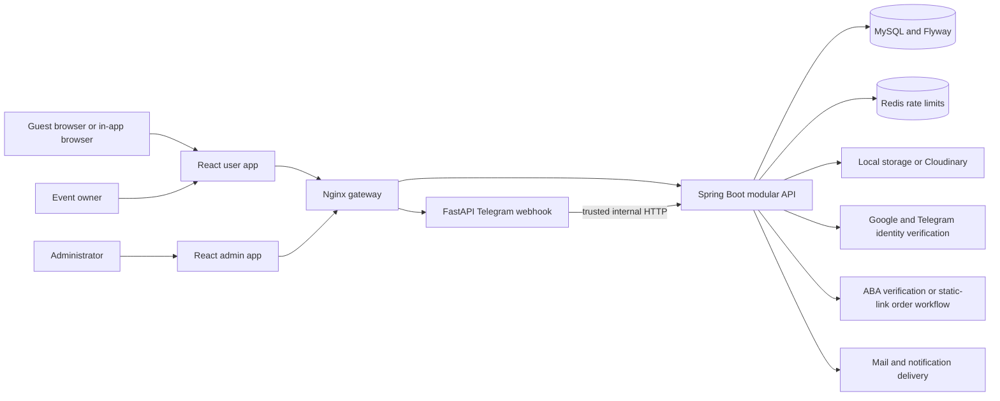
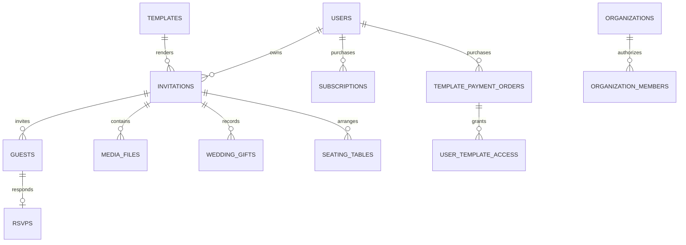

# Repository and architecture inventory

## Observed structure and manifests

| Area | Current implementation |
|---|---|
| `apps/frontend-user` | JSX React app, pages as route adapters, feature modules, shared APIs/UI, Zustand stores, template layouts/assets |
| `apps/frontend-admin` | Separate JSX app, admin guards/provider, management features and fullscreen template editor |
| `apps/backend` | Maven wrapper, Java 25, Spring Boot **4.1.1** (actual POM overrides older router examples), modular `api/application/domain/infrastructure` packages |
| `apps/telegram-bot` | FastAPI webhook/reconciliation delivery service, HTTPX, startup and pytest suites; no independent AI service discovered |
| `infra` | Nginx proxy templates, MySQL privilege SQL, Redis/Prometheus integration, backups, firewall/tunnel helpers |
| `.github/workflows/ci.yml` | Pinned actions; secret scanning, backend verification/static analysis, frontend checks, additional service/database gates |
| `docs`, `output` | Extensive earlier QA/design work and generated evidence. Historical PASS statements were not treated as new evidence. |
| `.agents` | Router, skill index, pinned skills. Primary QA + supporting UI/UX Pro Max/Playwright used in this phase. |

Metadata inventory covers **1,619 text source/config/test files, 225,868 lines**, including a large OpenAPI test contract. This is an automated inventory, not a claim that every line received manual review. [Source inventory](evidence/source-inventory.json) records every scanned path and size. All 27 backend module directories were catalogued. Targeted review followed public routes, owner creation/editor/guest/payment journeys, administrative management, access policies, media, migrations and deployment boundaries.

## Dependencies actually declared

| Component | Manifest versions / use |
|---|---|
| User app | React/DOM `^19.3.1`, Router `^7.18.2`, Vite `^8.3.5`, Tailwind `^4.3.3`, Axios `^1.19.0`, Zustand `^5.0.16`, Framer Motion `^14.5.0` |
| Other user runtime | Lucide + React Icons, jsQR, react-qr-code, PropTypes. Two icon families already coexist; avoid adding a third. |
| Admin app | Same React/Router/Vite/Tailwind/Axios; dnd-kit core/sortable/utilities; Lucide. No need for a second global state library. |
| Tests | Vitest `^5.0.5`, happy-dom `^21.0.4`, Testing Library, Playwright `^1.64.1`, axe Playwright `4.14.0` in user app |
| Backend | Spring Security/resource server, JPA, Redis, validation, Flyway/MySQL and PostgreSQL drivers, mail, Actuator/Prometheus, POI, ZXing, springdoc Scalar; Jackson 2 APIs explicitly managed alongside Boot infrastructure |
| Telegram | FastAPI `0.156.4`, HTTPX `0.28.1`, python-dotenv `1.2.4`, Uvicorn `0.54.0`, certifi `2026.10.23` |

Manifests and lockfiles are the dependency inventory of record; [dependency-inventory.json](evidence/dependency-inventory.json) lists every declared frontend dependency with locked/installed versions, backend declarations/properties and Python requirements. No upgrade or reinstall occurred. Installed runtime used Node 26.12.1/npm 11.20.0, Java 25.0.1 and Python 3.15.1. CI declares Node 22; this audit did not reproduce a clean Node 22 install.

## Frontend contracts

- User routing: `src/app/router.jsx` composes `builderRoutes`, `authRoutes`, `marketingRoutes`, `hostRoutes`. Lazy page definitions are in `app/routes/lazyRoutePages.js`; Home is eager. There are 111 user leaf patterns including aliases, nested event modules and wildcard.
- Admin routing: `src/app/App.jsx` + `app/routes.js`, 24 leaves including legacy aliases and wildcard. `RequireAdmin` is distinct from customer authentication. Do not broaden roles when moving navigation.
- `features/*/api` wraps shared Axios `shared/api/httpClient.js`; normal success envelopes are unwrapped, whereas auth responses can be direct DTOs. Interceptors carry locale/request/action metadata and handle expiry/401 recovery.
- Zustand handles auth, language, appearance and editor state. `QueryProvider` currently returns children; **React Query is not installed**. Forms largely use React state and native controls; React Hook Form/Zod are not current foundations.
- Session storage is the default customer bearer-token store; optional localStorage/cookie modes exist. Admin storage is separately named. Server-backed events and legacy local drafts intentionally take different paths.
- Shared `Modal`, `FormField`, `ResponsiveTable`, feedback, skeletons, date/time controls and tokens already exist. Template themes are independent of management appearance. User-visible invitation fonts and colors must not be globally recolored.

## Backend/database boundaries

Modules: admin, audit, auth, budget, checkin, contact, delivery, dev, devmonitor, entitlement, event, gift, guest, integration, invitation, media, notification, organization, payment, reporting, rsvp, seating, shared, subscription, template, ticket, user. [Annotation inventory](evidence/backend-annotation-inventory.json) records 622 mapping/security/transaction/table/lock annotations and exact line locations; it is not a substitute for the runtime OpenAPI contract.

There are **48 migration files through V51**, with deliberate numeric gaps; gaps alone are not a defect. Checksums, created tables and index declarations are in [migration inventory](evidence/migration-inventory.json). Fresh MySQL application, applied checksums, collation behavior and concurrent uniqueness remain unverified because the database gate was skipped.

This diagram summarizes domain associations, not a reverse-engineered live schema or every physical constraint. [Backend compatibility report](13-backend-api-database.md) details the critical invariants.
