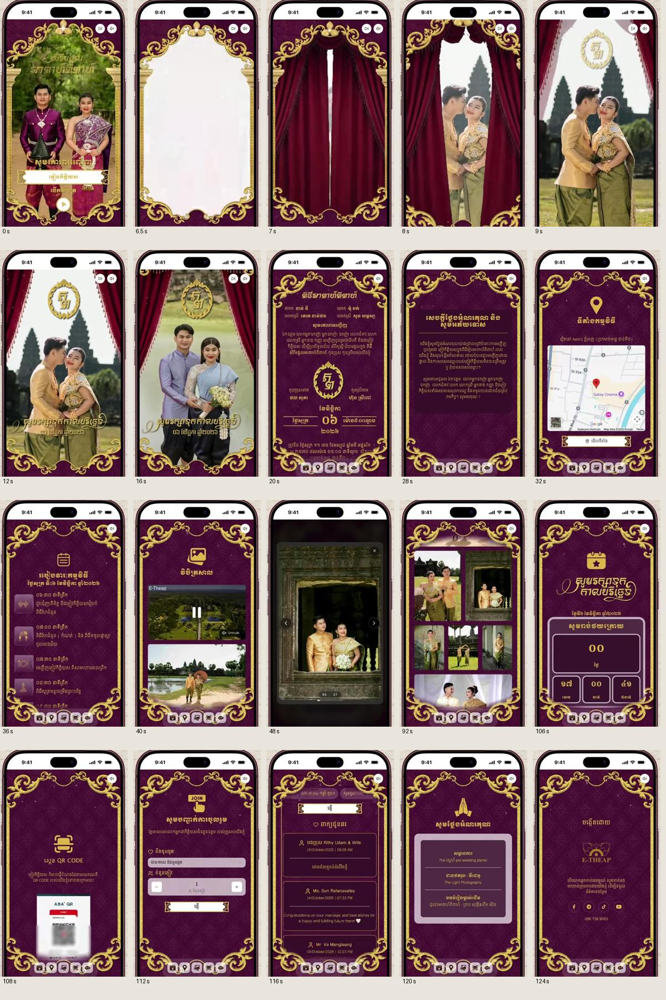

# Royal Garden V4 reference analysis

Reference: owner-supplied `Royal-Garden-Cinematic-new-Ui.mov` and `overview.jpg`. Frames extracted directly with FFmpeg 7.1 through the installed imageio-ffmpeg executable. These are visual references, not a source of guest identities, QR codes, branding or application instructions.

| Reference | Composition / interaction | Implementation gap before changes |
| --- | --- | --- |
| 00:00 | Burgundy gold arch, full portrait, small Khmer title, guest plaque, circular open control | Existing gold arch and owner cover supported; blue artwork, oversized lower artwork bands |
| 00:06.5–00:09 | Cover dissolves, closed velvet panels, center opening with sweeping upper corners | No Royal Garden curtain; no-film path immediately finishes |
| 00:12 / 00:16 | Full-height portraits crossfade; gold crest at top; calligraphy below; curtains linger at edges | Existing slideshow is bypassed for royal-arch; protected video already supported |
| 00:20 / 00:28 | Continuous formal invitation within stationary ornament; compact centered Khmer hierarchy | Existing canonical family/message/date renderers retained |
| 00:32 | Venue/map within gold border | Existing illustrated/Google/sketch integrations retained; use actual venue |
| 00:36 | Multi-day icon timeline | Existing ProgramTimeline retained |
| 00:40 / 00:48 | Gallery entry and manually explored contain-fit lightbox | Carousel only; modal exists but keyboard/touch events do not reach portal |
| 01:32 | Mixed portrait/landscape collage, narrow gutters | No collage |
| 01:46 / 01:48 | Save date/countdown followed by QR | Existing interactive calendar and USD/KHR gifts retained |
| 01:52 / 01:56 | RSVP and wishes | Keep backend RSVP; private guest messages remain private |
| 02:00 / 02:04 | Ceremonial thanks, apology, brand sign-off | Existing ceremonial letters and Koupreng branding retained |

Recording time includes deliberate scrolling and gallery navigation. It does not prescribe automatic scene duration. No recorded phone/status bar, sample couple, payment QR or unrelated brand will be copied.

Design plan: burgundy `#420b2b`, velvet `#260617`, gold `#f2d693`, warm gold `#c8a351`, ivory `#fff6df`. Moul for ceremonial Khmer, Battambang for readable body copy, Cormorant Garamond for Latin. One proportional portrait canvas, centered ceremonial type, fixed outer ornaments, native inner scroll. The original blue artwork remains available; the burgundy preset uses new transparent gold scrollwork and a generated velvet texture animated by CSS. A selective SVG color filter handles the supplied original border when used with a custom background. Owner uploads are excluded from the filter. No app assets are taken from extracted screenshots.
