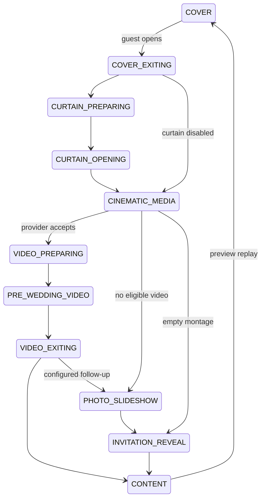

# Scene state machine

The existing `useIntroSequence` owns all Royal Garden scene stages. The existing `CinematicOpeningProvider` continues owning media eligibility, protected requests and video recovery. No second media loader or invitation renderer was introduced.

Skip finishes from every gate state. Replay increments the run token and cancels the old timer. Video callbacks carry that token, so stale or duplicate completion cannot re-enter a previous sequence. Repeated Open actions are ignored once a run has started. One remaining-duration timer pauses with visibility or the montage Pause control. Effects clean up on unmount. No information sections or focusable RSVP inputs exist behind the gate. The fading cover is inert and removed after its exit.

Legacy oval and calligraphy stage names and durations remain supported. The existing protected-video provider and its authorization checks are unchanged. Royal video audio stays permanently muted; the single background audio element remains mounted outside the scene switch.
