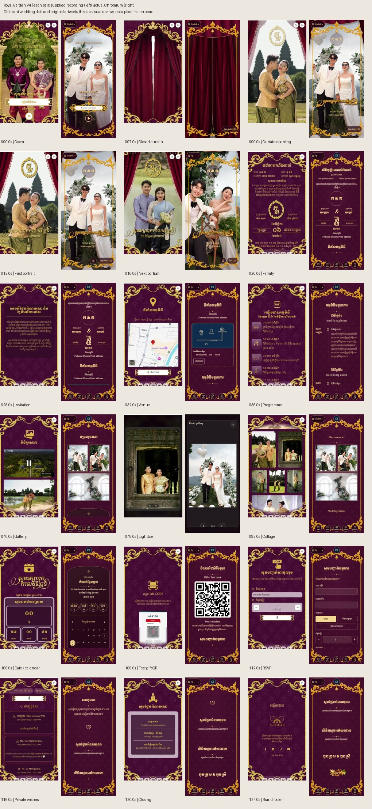
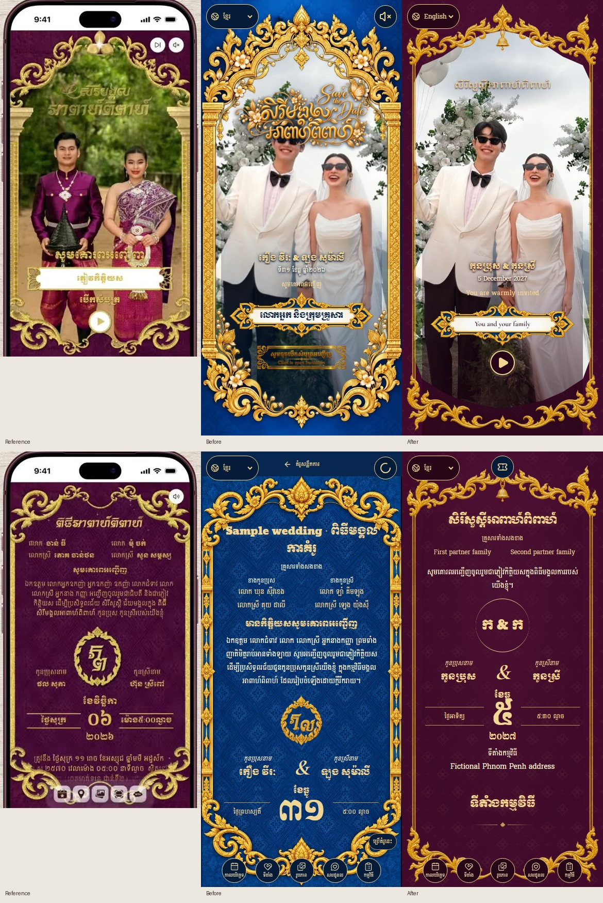

# Reference comparisons

These comparison sheets describe the initial V4 baseline. Later user-supplied Pich/Pisey photos and the direct-film opening are shown in [the responsive refinement](11-direct-video-responsive-refinement.md).

Actual video frames, pre-change Chromium captures, and final Chromium captures are retained together. `evidence/reference/` contains recording frames, including its phone shell for analysis only. `evidence/browser/` contains the application without a phone/status bar. All app screens use test wedding data and existing project photographs, never the reference couple's identity.

| Reference | Actual application capture | Review |
| --- | --- | --- |
| 00:00 | [Cover](evidence/browser/after-cover.png) | New burgundy canvas, slimmer gold scrollwork, portrait, actual title/guest plaque and circular open control |
| 00:07 | [Closed curtain](evidence/browser/after-curtain-closed.png) | Textured cloth, fine center gold seam, upper valance, persistent frame |
| 00:09 | [Opening curtain](evidence/browser/after-curtain-opening.png) | Center-out transform with first portrait underneath; no information behind it |
| 00:12 / 00:16 | [First portrait](evidence/browser/after-portrait-first.png), [next portrait](evidence/browser/after-portrait-second.png) | Same owner montage array, focal settings, live monogram and date |
| 00:20 / 00:28 | [Family](evidence/browser/scene-family.png), [invitation](evidence/browser/scene-invitation.png) | Compact centered family/names/date with persistent background |
| 00:32 / 00:36 | [Venue](evidence/browser/scene-venue.png), [program](evidence/browser/scene-schedule.png) | Existing illustrated map, actual program model, time column, icons and connectors |
| 00:40 / 01:32 | [Collage](evidence/browser/scene-gallery.png) | Natural portrait/landscape proportions, narrow gold frames and gutters |
| 00:48 | [Portrait lightbox](evidence/browser/after-lightbox-portrait.png), [landscape](evidence/browser/after-lightbox-landscape.png) | Dark contain-fit media, counter, keyboard/touch navigation and close |
| 01:46 | [Date/calendar](evidence/browser/scene-countdown.png) | Existing four countdown circles, interactive calendar and ICS functionality retained |
| 01:48 / 01:52 | [Gift](evidence/browser/scene-gift.png), [RSVP](evidence/browser/scene-rsvp.png) | Test-only QR, unchanged currency/access semantics, royal form styling and real submission component |
| 01:56 | [Wishes](evidence/browser/scene-wishes.png) | Private-message notice; no exposure of private RSVP messages |
| 02:00 / 02:04 | [Closing](evidence/browser/scene-closing.png), [footer](evidence/browser/scene-footer.png) | Calm ceremonial thanks/apology, live names and Koupreng branding |

Three focused review passes were completed. Composition replaced the mismatched heavy blue default in the marketing sample with a new burgundy frame and created cloth artwork. Motion added the center opening, portrait handoff, run-token cleanup and reduced-motion path. Guest UX replaced the carousel-only default with an optional collage, fixed lightbox input/failure states, matched the real RSVP form, and checked all requested viewport sizes. Final refinements improved initial-crest contrast and gave closing its own reading space.

Remaining differences: gold scrollwork is original reference-inspired artwork, not the exact recorded frame; textile folds, curtain trajectories and calligraphy differ. Owner photographs, names, dates, maps, QR data and branding intentionally remain specific to the actual invitation. The reference uses a public wishes wall and a different countdown layout; this implementation preserves private RSVP policy and the richer existing calendar. Recording timestamps cannot be compared as automatic durations because the reference is manually browsed. No claim of a 100% pixel match or human visual approval is made.
