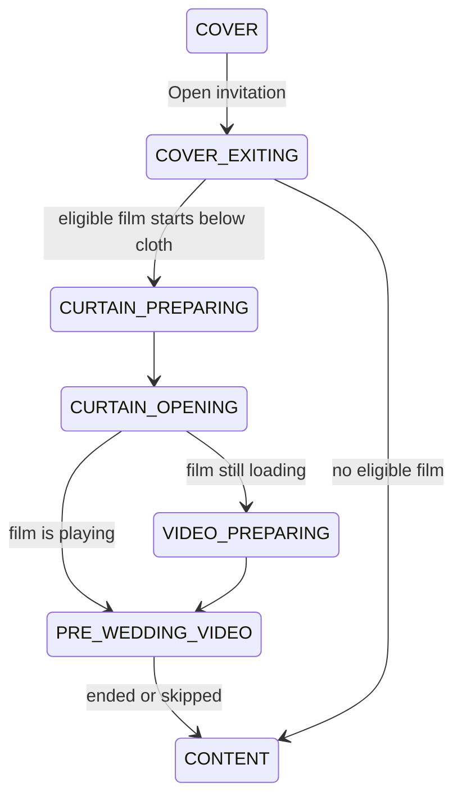
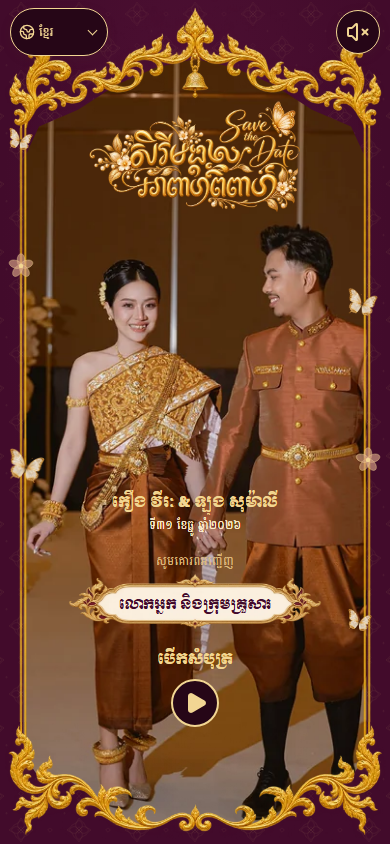
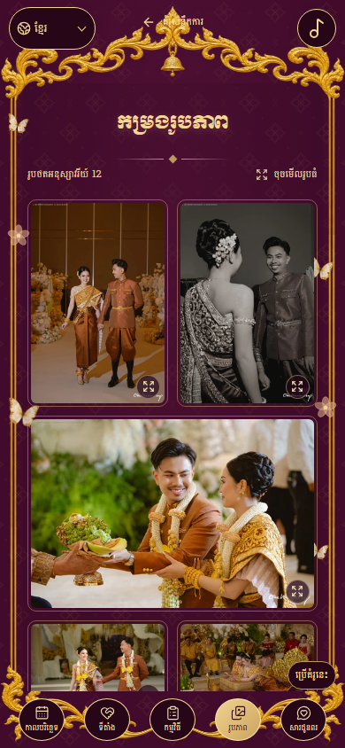

# Direct video and responsive refinement

The final generated kbach guest frame, title, motion and page 3 styling are documented in [the next refinement](12-kbach-guest-and-motion.md).

The follow-up changes implement the user's screenshots and corrections to `/templates/royal-garden-cinematic`. The latest screenshots take precedence over the original reference's portrait handoff. Reference material supplies visual direction; it does not change application authorization or guest data contracts.

## Result

- Page 1 has no entrance-stage shadow, dark vignette, lettering shadow or pulsing button shadow. After the user's final border correction, the lower photo mask follows the actual lower gold stem instead of extending to the canvas edge. Width-based offsets track the frame's nine-slice scale at different heights, filling the aperture while keeping the photo inside the ornament.
- Open invitation starts the existing eligible film beneath the burgundy curtains. Opening cloth reveals the film directly, without the previous ornate portrait page. Small folds remain at the upper left and right when the opening finishes. Skip, replay, visibility pause, missing-video recovery and reduced motion still use the existing sequence and media provider.
- Page 2 preserves the original `រ ល` crest, Save the Date artwork and live date. A newly generated transparent burgundy/gold footer replaces the blue footer for Burgundy Heritage. It sits approximately 1.45% of canvas width lower to remove its transparent baseline gap. Other saved palettes retain their existing footer assets.
- The portrait canvas fills the available viewport height without the previous desktop top/bottom inset. Video fills its canvas. Controls compress on narrow and short screens. At viewport heights of 600px or less the cover uses a 640px minimum canvas and native page scrolling, keeping its text and open control readable instead of squeezing them together. A narrow-screen guest label scales into its plaque.
- Page 3's side ornaments extend outward by 2% on each side. Its reading gutters shrink from 10% to 6.5%; top and bottom ornament clearances are reduced. The content region occupies 87% of canvas width and more than 72% of height at the tested portrait/tablet/desktop sizes. Short landscape sizes retain more than 60% of height. Information keeps one native inner scroll, and the complete ending remains reachable.
- The user's physical-phone screenshots exposed an additional clipped navigation/outer-page gap that desktop-only geometry checks did not catch. Navigation, Back and catalog actions now sit outside the content scroll element. Section buttons are anchored to the canvas and all five remain visible. A fixed invitation canvas follows `visualViewport.height` (including toolbar/keyboard resizing), while native inner scrolling handles the information. Section links scroll that element directly. The explicit owner opt-out from fixed framing retains its document layout. Touch hit-testing and section jumps pass in both mobile Chromium and Windows WebKit across five changing viewport sizes.
- All 12 supplied Pich/Pisey photographs appear in the public catalog sample. A full-length portrait is used for the cover. Gallery thumbnails are 480px wide; opened photographs are 1280px wide. The final portrait spans both gallery columns to avoid an empty last cell. Host-authored invitation photographs and data retain their existing precedence.

## Current opening



The hook still owns a single run token and phase timer. Media readiness is recorded on that same sequence state during opening; it does not restart the curtain or invalidate its timer. Protected media is requested only after Open, through the existing provider. A muted inline video remains separate from the invitation soundtrack. An explicitly configured owner photo follow-up remains supported after the film. Reduced motion retains the existing immediate information reveal.

## Photo preparation

Source: user-provided `C:\Users\ASER Nitro\Downloads\pich_pisey wedding.zip` (12 JPEGs). `scripts/design/prepare-royal-garden-pich-pisey.py` reads pixel bytes directly from the ZIP, applies orientation, preserves visible photographer marks, and writes only controlled WebP filenames. It does not extract archive paths or publish original JPEG metadata. The 25 derived assets total 2,981,642 bytes; photo 03 also has a 640px cover variant. The ZIP and original JPEGs are not committed.

Command run from repository root:

```powershell
python scripts/design/prepare-royal-garden-pich-pisey.py 'C:\Users\ASER Nitro\Downloads\pich_pisey wedding.zip'
```

Result: 12 photos prepared successfully under `apps/frontend-user/public/templates/royal-garden/v4/pich-pisey/`.

## Footer generation

The existing transparent `v3/video/footer.webp` supplied the bounding geometry. The image generation tool created an original Khmer leaf/jasmine/flame ornament with a burgundy silk inset. The generated RGBA source was 2170×725. Responsive WebP exports are 640×213, 1280×426 and 1920×640, with transparent upper negative space. Total asset size is 450,158 bytes; only the appropriate responsive resource is selected by the browser.

Exact prompt:

> Use case: style-transfer. Asset type: production transparent foreground ornament for the BOTTOM of a Cambodian wedding pre-wedding video. Edit the supplied footer into an original, distinctive Burgundy Heritage and gold footer. Keep its exact 3:1 wide rectangular canvas, bottom alignment, transparent upper negative space, and overall shallow U-shaped silhouette so the existing calligraphy and wedding date ABOVE it remain at the same positions. Match the reference's bounding geometry: the outer left and right gold flourishes rise near the upper corners; the small center crest reaches only to around 47% of the canvas height (y=150 on a 960x320 canvas), with a broad low, open concave curve between the sides and the central crest. Recreate the ornaments as fresh, refined Khmer kbach gold filigree: slender flowing curling leaf tendrils, fine hand-engraved gold highlights, tiny jasmine buds worked into the base, a small elegant stylized lotus/flame crest at the center rather than the same old shield. Rich burgundy silk inset (#3f0829) ONLY beneath the curved gold line, where the reference is blue, subtly patterned with small woven diamonds. Thin double gilded baseline at the bottom. The gold composition should be unique and balanced, delicate rather than bulky. Make the upper empty middle and every area above the curved ornamental silhouette genuinely transparent so the moving couple video shows through. Do not add any extra upper border, complete frame, title, monogram, letters, date, people, photo, phone, watermark or logo. Do not raise the center ornament or fill the transparent upper opening. Preserve the 3:1 aspect ratio and all alpha in the empty area. Output just this one finished footer asset, suitable for direct overlay on video.

## Render evidence

Chromium screenshots and geometry checks cover these 15 CSS viewport sizes: 280×640, 320×480, 320×568, 360×640, 375×667, 390×844, 412×915, 430×932, 540×720, 768×1024, 834×1194, 844×390, 1024×768, 1440×900 and 1920×1080. Cover and information captures reflect the latest shadow, mask and spacing changes. The video sweep also checks autoplay after the opening gesture, one protected request, original artwork sources/anchors, settled curtain folds, footer alignment, separated controls and no horizontal document overflow.






## Checks and limits

Commands ran from the repository root on Windows. Logs are retained under [`evidence/video-footer/checks/`](evidence/video-footer/checks/).

| Command | Result |
| --- | --- |
| `npm --prefix apps/frontend-user run test -- src/features/templates/layouts/RoyalGardenCinematic src/features/templates/experience/TemplateExperience.test.jsx` | 7 files, 100 tests passed; 6.36s |
| `npm --prefix apps/frontend-user run test -- --maxWorkers=2` | 195 files, 1,389 tests passed; 113.41s |
| `npm --prefix apps/frontend-user run lint` | Passed, exit 0 |
| `npm --prefix apps/frontend-user run build` | Passed; final application build 2.69s |
| `npm --prefix apps/frontend-user run test:e2e -- --config playwright.royal-garden-v4.config.js royal-garden-v4.spec.js royal-garden-video-footer.spec.js --grep 'page two retains\|catalog uses\|Pich-Pisey catalog\|curtains directly' --workers=1` | 4 passed; 1.7m, including all 15 video/cover/information sizes |
| `npm --prefix apps/frontend-user run test:e2e -- --config playwright.royal-garden-v32.config.js --project=chromium --grep 'catalog: supplied film\|hosted: authorized protected film\|soundtrack: one real song\|lower film lettering\|unavailable video' --workers=1` | 5 passed; 48.3s |
| `npm --prefix apps/frontend-user run test:e2e -- --config playwright.royal-garden-v4.config.js royal-garden-video-footer.spec.js --grep 'catalog uses\|Pich-Pisey catalog' --workers=1` | Final border-only rerun: results in `border-responsive.txt`; refreshes all 15 cover/information sizes |
| `git diff --check` | Passed |

The soundtrack regression captures use `ROYAL_EVIDENCE_DIR=../../docs/design/royal-garden-v4/evidence/video-footer/regression` so historical V3 screenshots remain intact. Final cover capture waits for the guest plaque as well as the photo/frame to decode, and records the complete scrollable short cover.

Failures investigated during this follow-up:

- Media readiness changed the sequence object's identity during a curtain phase. Its old timer identity check could reject a valid phase completion. Comparing run, stage and slide fixes this without adding a second timer; two new hook cases exercise readiness beneath the curtain and an early film completion.
- An early full unit run while the viewport sweep was running had 10 failures (six files), including `Test timed out in 5000ms` and assertions against still-loading lazy components. The final full run alone with two workers passes all 1,389 cases. The earlier failing log is retained as `initial-full-unit-failure.txt`.
- Older browser checks assumed a fixed 4px date/footer gap and that a visible film meant the curtain had finished. Actual failures included `Expected: 4; Received: 10.4296875` and a keyboard gate assertion `Expected: false; Received: true`. The gap check now includes the intentional footer offset. The film helper waits for `PRE_WEDDING_VIDEO` before its keyboard audit, so Space cannot activate the still-focused curtain Skip button. Film content is paused during that long audit while the song continues. All five final regression cases pass.
- A clock-controlled curtain test initially fast-forwarded to a past timestamp. It now installs a fixed starting time and advances to a future timestamp; the direct-film test passes.
- The user's last screenshot exposed the lower photo extending past the gold outline after its mask was extended to 100% height. The final mask follows the gold stem using the frame's width scale. Phone and desktop captures were inspected after this correction.

Happy DOM reports its configured external iframe/font loading restrictions in unit output; the final suite still exits 0. PowerShell also renders Node's `NO_COLOR`/`FORCE_COLOR` warning as `NativeCommandError` text in successful browser logs. All browser tests use local Chromium with mocked API fixtures and the real bundled video; they do not certify every physical phone or production media service. Native Safari, Firefox, real touch hardware and production deployment have not been verified in this follow-up. No backend or database source changed.
