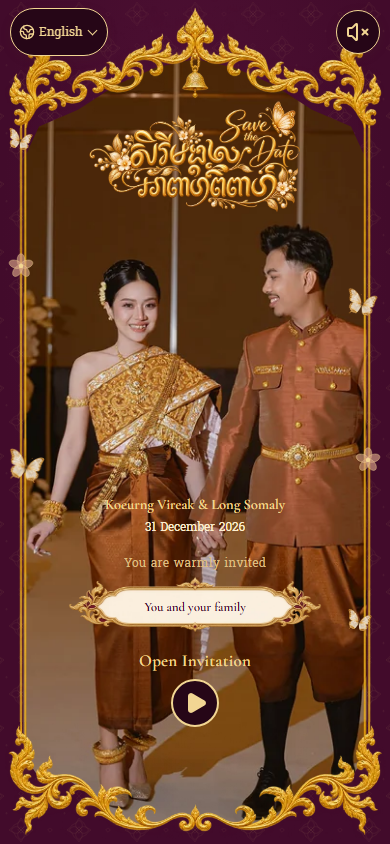
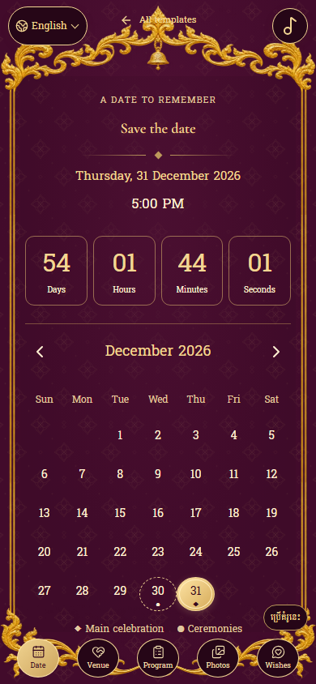
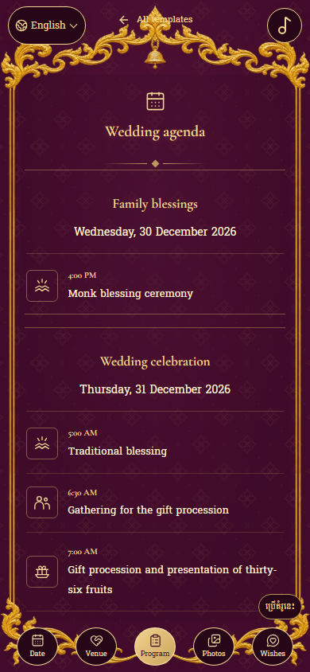
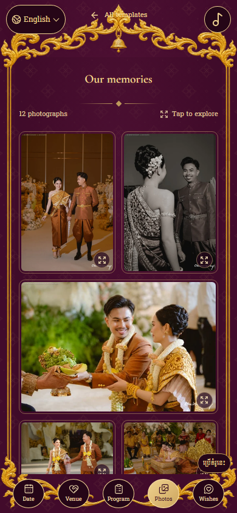

# Khmer kbach guest frame and guest experience styling

Current follow-up details are in [the final layout, locale and action notes](13-final-layout-locale-actions.md). This design phase implements the user's reference: an original generated guest-name ornament, the exact heading `សិរីមង្គលអាពាហ៍ពិពាហ៍`, more motion and decorative life, and cleaner calendar, countdown, two-day programme and gallery styling. It follows the [direct-film and responsive repair](11-direct-video-responsive-refinement.md).

## Applied design

The new guest-name frame uses engraved gold Khmer curling lotus/flame ornament, small burgundy enamel details and an ivory writing field. Its exterior has genuine alpha transparency. The guest's name is live, selectable React text, sourced through the existing authorized guest-name resolver. It is never baked into the image. Longer names can wrap to two lines, with the complete name available to assistive technology and the title attribute. The generated ornament replaces the blue/white guest plaque for Burgundy Heritage; other saved palettes retain their existing artwork.

Page 1 now uses the exact existing `golden-calligraphy.webp` artwork requested by the user, with responsive 640px and 1100px derivatives. The live two-line Khmer title remains an accessible fallback for a failed image or an owner-selected text title. There is no added title panel or shadow. Page 2's approved crest and Save the Date image remain unchanged.

Page 3 uses its existing burgundy canvas throughout. Calendar, countdown, programme and gallery tiles have no added background panels or shadows. Their styling comes from thin gold rules, outlined date/day controls, typography, spacing, rounded photo edges and clear selected states. Calendar date highlights and navigation buttons retain functional selected-state colors.

The calendar and programme share the same resolved wedding days. The sample shows the day before the wedding and the main wedding date; host-authored dates and ceremony rows are not replaced. The duplicate day cards and selected-day ceremony panel were removed following the user's annotated screenshots. Countdown still targets the canonical main celebration. A single gold Add to Calendar action sits below the calendar and is enabled for the public sample at the user's request. Host-authored visibility settings are respected.

Gallery photographs retain their natural proportions. Two-column groups alternate with selected full-width photographs. The lightbox keeps original-resolution images, keyboard arrows, swipe, pinch zoom, loading/error states and close-focus restoration. A new thumbnail strip allows a direct jump to any photograph.

## Motion

- Open invitation has a breathing gold border, a gently animated icon and an occasional sheen contained inside the control. Its touch target stays stationary and its outside shadow remains disabled.
- The existing curtain/video sequence remains the only opening sequence. Video eligibility, gesture-triggered loading, muted inline playback and the separate soundtrack retain their existing ownership.
- Section, calendar, programme and photo reveals use short native animations inside the information scroll root. Photo hover and lightbox changes have restrained finite transitions.
- The public sample uses the existing cinematic motion preset. Its budget remains 16 mobile / 18 desktop particles, with four mobile / five desktop butterflies, plus two or three small vector blossoms. Other presets use two or three butterflies. Gold, champagne and rose/burgundy petal colors match the invitation. Flights take 16–24 seconds; wing motion takes 1.5 seconds. Effects remain near the sides, clipped to the canvas, and cannot intercept touches.
- Reduced motion and data-saving preferences suppress the decorative budget. Hidden pages pause decoration. The reduced-motion opening still reveals the information directly.

## Generated asset

Built-in `image_gen` was used. The actual generated RGBA source is 2172×724; alpha extrema are 0 and 255. The output was exported without changing its composition:

| Project asset | Dimensions | Bytes |
| --- | --- | --- |
| `apps/frontend-user/public/templates/royal-garden/v4/guest-kbach-600.webp` | 600×200 | 28,878 |
| `apps/frontend-user/public/templates/royal-garden/v4/guest-kbach-1200.webp` | 1200×400 | 89,208 |

The browser selects the responsive resource. The original generated PNG remains at `C:\Users\ASER Nitro\.codex\generated_images\01a1b3c8-281b-70e0-98b9-b692c29992fa\exec-6f59ca95-c71a-42a1-bbb3-f13842854907.png`.

Exact generation prompt:

> Use case: stylized-concept. Asset type: a production transparent PNG ornamental guest-name cartouche for a Cambodian wedding website called Royal Garden Cinematic. Create ONE unique, exquisitely engraved Khmer kbach horizontal gold name frame, inspired by traditional Cambodian wedding invitation filigree. Canvas 4:1, wide horizontal, transparent outside. The center is an uninterrupted, clean, warm ivory (#fff8e8) name-writing field, taking roughly 70% of canvas width and 56% of height. It must be empty of any text or symbols, because a live guest name will be displayed there by the website. A narrow finely engraved antique gold and champagne-gold double rim surrounds that ivory field. At the left and right ends: tasteful original symmetrical Khmer curling acanthus/flame/lotus tendrils that match a luxurious burgundy and gold Khmer wedding arch, delicate and airy rather than bulky. Tiny burgundy enamel (#420b2b) details may appear only within the outer gold ornament. A very small center lotus/flame finial at top and bottom, short enough not to consume the name field. The overall design is a modern, elegant slender ceremonial plaque, with a gently scalloped silhouette and ample readable space. Three-dimensional gold engraving is polished but not excessively shiny. Keep the entire ornament inside the canvas with 2% transparent edge safety. No blue anywhere. No separate background, no card behind the ornament, no cast shadow outside its silhouette. Every pixel outside the ivory/gold plaque silhouette must have genuine alpha transparency, not a white/checkerboard background. No words, no letters, no numbers, no initials, no logo, no people, no watermark. Output only the isolated finished frame asset.

## Evidence and verification

The full guest/calendar/programme/gallery/lightbox flow was captured at 320×568, 390×844, 844×390, 768×1024 and 1440×900. The test checks the live guest name, opening-control animation, butterfly budget, reduced-motion fallback, both ceremony days, calendar download, map link, bilingual names, transparent/shadow-free page 3 surfaces, direct thumbnail navigation and no horizontal or outer-page scrolling. Results and commands are retained in `evidence/video-footer/checks/`.

The first new browser run found that the sample still inherited the old subtle preset (`Expected: 4; Received: 2` butterflies). The sample now explicitly selects cinematic motion; owner presets keep their existing precedence. Older tests requiring demonstration export controls to be absent were updated to exercise the newly requested calendar action. The final page has neither duplicate day cards nor a selected-day details panel.

The final curtain request preserves page 2's layout while leaving approximately 20% of canvas width as cloth at each top corner. The panels taper out before 40% of canvas height, keeping the central film unobstructed. Opening takes 2.6s standard / 3.4s gentle, with a soft initial pull and eased settling. The timer and curtain component share one duration function, and animated/static folds use the same final geometry. The valance exits fully before handoff. A continuous movement of the whole Open button initially caused browser clicks to wait for a stable target; its motion now stays inside the stationary touch area. Tests continue to use normal clicks, without forcing interaction.

Native physical iOS/Android devices and production APIs were not certified by this work. Automated mobile WebKit runs use the installed Windows WebKit engine, with actual touch hit-testing and viewport resizing; that is not a claim of native Safari playback certification. No production deployment was performed.
