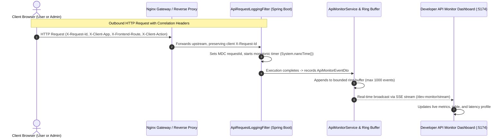

# Koupreng Developer API Monitor & End-to-End Request Tracing

## 1. Overview

The **Koupreng Developer API Monitor** provides real-time, backend-observed HTTP telemetry and end-to-end request tracing across the Koupreng E-Invitation system.

It allows engineers and administrators to open the **User Website** (`http://localhost:5173`) and the **Admin Dashboard** (`http://localhost:5174`), execute user journeys (e.g. registration, authentication, invitation creation, RSVP submissions, and payments), and immediately observe genuine HTTP activity stream into the monitor at `http://localhost:5174/dev/api-monitor`.



---

## 2. Diagnostic Header Contract

Every outbound request issued by the centralized Axios clients (`apps/frontend-user/src/shared/api/httpClient.js` and `apps/frontend-admin/src/shared/api/adminHttpClient.js`) is automatically enriched with the following diagnostic headers:

| Header | Format / Example | Description |
| :--- | :--- | :--- |
| `X-Request-Id` | `[A-Za-z0-9._-]{8,100}` (e.g. `c7b39f60-91a2-4a0b-967b-123456789abc`) | End-to-end correlation ID generated by the frontend, preserved by Nginx, and logged across backend logs (SLF4J MDC). |
| `X-Client-App` | `frontend-user` \| `frontend-admin` | Identifies which client application initiated the API call. |
| `X-Frontend-Route` | `[A-Za-z0-9._/~-]{1,100}` (e.g. `/register`, `/templates/canva-khmer`) | The browser URL pathname where the user was located when making the call. |
| `X-Client-Action` | `[A-Za-z0-9._-]{1,50}` (e.g. `REGISTER_SUBMIT`, `LOGIN_SUBMIT`, `UPDATE_TEMPLATE`) | High-level semantic action metadata specified by the feature triggering the request. |

### CORS Configuration
The backend CORS policy explicitly allows these correlation headers in `ApiSecurityProperties` and `application.properties`:
```properties
app.security.cors.allowed-headers=${CORS_ALLOWED_HEADERS:Authorization,Content-Type,X-Requested-With,X-Request-Id,X-XSRF-TOKEN,X-Frontend-Route,X-Client-Action,X-Client-App}
```

---

## 3. Reverse Proxy & Infrastructure Preservation

In `infra/nginx/docker/gateway.conf.template` and `infra/nginx/koupreng-api.conf`, Nginx uses a map to preserve any frontend-generated `X-Request-Id`, falling back to its internal `$request_id` only if the incoming header is absent:

```nginx
map $http_x_request_id $koupreng_request_id {
    default $http_x_request_id;
    "" $request_id;
}
```

For the live streaming endpoint (`/api/v1/admin/dev-monitor/stream`), proxy buffering is disabled to ensure instant, unbuffered SSE event delivery:

```nginx
location /api/v1/admin/dev-monitor/stream {
    proxy_pass http://koupreng_backend;
    proxy_http_version 1.1;
    proxy_set_header Host $host;
    proxy_set_header X-Real-IP $remote_addr;
    proxy_set_header X-Forwarded-For $proxy_add_x_forwarded_for;
    proxy_set_header X-Forwarded-Proto $koupreng_forwarded_proto;
    proxy_set_header X-Request-Id $koupreng_request_id;
    proxy_set_header Connection '';
    proxy_buffering off;
    proxy_cache off;
    chunked_transfer_encoding off;
    proxy_read_timeout 24h;
}
```

---

## 4. Backend Architecture & Invariants

The backend telemetry infrastructure is organized in `com.koupreng.backend.devmonitor` respecting clean architecture boundaries validated by ArchUnit:

```text
com.koupreng.backend.devmonitor/
  ├── api/
  │    ├── ApiMonitorController.java      # REST endpoints (/events, /stats, /stream, /clear)
  │    └── dto/
  │         ├── ApiMonitorEventDto.java   # Immutable event record
  │         ├── ApiMonitorStatsDto.java   # Aggregated telemetry summary
  │         └── EndpointStatDto.java      # Per-endpoint call & latency metrics
  ├── application/
  │    ├── ApiMonitorProperties.java      # Config properties (app.dev-monitor.*)
  │    └── ApiMonitorService.java         # SSE subscription manager & event broadcaster
  └── infrastructure/
       └── ApiMonitorEventStore.java      # Thread-safe bounded ring buffer (ConcurrentLinkedDeque)
```

### Safety & Operational Invariants
1. **Zero Secret Leakage:** Request and response bodies are never recorded or logged. Query strings redact sensitive keys (`token`, `password`, `secret`).
2. **Feature Flagging:** Controlled via `app.dev-monitor.enabled`. Enabled by default in local development (`application.properties`), disabled by default in production (`application-prod.properties`).
3. **Role-Based Security:** Endpoints under `/api/v1/admin/dev-monitor/**` require `ROLE_ADMIN` authorization.
4. **Loop Prevention:** Telemetry calls to `/api/v1/admin/dev-monitor/**` and `/api/health` are explicitly skipped by `ApiRequestLoggingFilter` to prevent infinite event amplification loops.
5. **Bounded Memory:** The in-memory buffer (`ApiMonitorEventStore`) enforces a strict capacity limit (default 1000 events) by evicting the oldest entries when full.
6. **Monotonic Timing:** Request latencies are measured using `System.nanoTime()` to avoid clock skew or NTP jumps.

---

## 5. Admin UI Dashboard (V2.1)

The dashboard is accessible at:
```
http://localhost:5174/dev/api-monitor
```

### Key Capabilities in V2.1
- **Dedicated View Switcher:**
  - **Live Table (`table`):** High-density network view with density toggles (`Comfortable` vs `Compact`), multi-column sorting, search query highlighting, and quick cURL copy actions.
  - **Request Waterfall (`waterfall`):** Timeline visualization with zoom controls (`1x`–`3x`), action correlation grouping, automatic concurrency detection (`⚡ Concurrent / Parallel` vs `↳ Sequential`), and client-side transit latency overlays.
  - **Error Triage (`errors`):** Dedicated incident investigation panel aggregating 4xx, 5xx, and client network drops, top recurring error codes, and contextual remediation triage recipes.
  - **SQL Diagnostics (`sql`):** Database statement profiling tracking executed query counts, Hibernate `StatementInspector` AST template patterns, and prominent `POTENTIAL_N_PLUS_ONE` warning alerts.
  - **Combined View (`both`):** Synchronized dual view displaying both the Request Waterfall and the Live Request Table simultaneously.
- **7-Tab Request Details Drawer:**
  - *Overview:* Metadata summary, correlation tokens, quick cURL / JSON export actions.
  - *Timeline:* 5-stage milestone progression with "Inspect in Waterfall" navigation jump.
  - *Headers & Auth:* Masked credentials (`Authorization: Bearer ey...[SANITIZED]`), principal, and roles.
  - *Controller:* Spring Boot handler signature and matched route pattern.
  - *Database:* Executed SQL query count, Hibernate StatementInspector disclosure, and N+1 warning.
  - *Contract:* OpenAPI 3.0 specification alignment status (`MATCHED`, `COMPATIBILITY_ALIAS`, `UNTRACKED`).
  - *Errors:* Detailed error classifications and remediation steps for 4xx/5xx/network drops.
- **QA Session Recorder & Export:**
  - Live recording session timer (`Elapsed: MM:SS`).
  - In-session contextual note-taking.
  - Sanitized export in JSON and CSV formats, omitting sensitive tokens and passwords.
- **Command Palette (`Ctrl+K`):**
  - Full keyboard-driven navigation with Arrow Up/Down and Enter execution.
  - Shortcuts to toggle views, stream state, filter modes, and run QA actions.

---

## 6. Local Verification Runbook

To run and verify the complete flow locally:

1. **Start Backend:**
   ```powershell
   cd apps/backend
   ./mvnw spring-boot:run
   ```
2. **Start Admin Frontend:**
   ```powershell
   cd apps/frontend-admin
   npm run dev
   ```
   Open `http://localhost:5174/login`, log in with administrator credentials, and navigate to **System > API Live Monitor** (`http://localhost:5174/dev/api-monitor`).
3. **Start User Frontend:**
   ```powershell
   cd apps/frontend-user
   npm run dev
   ```
   Open `http://localhost:5173` in another tab, register or log in, view wedding templates, or submit an RSVP.
4. **Observe Real-Time Stream:**
   Watch requests appear in real time on the dashboard with correlation IDs, client actions, and backend execution durations.

