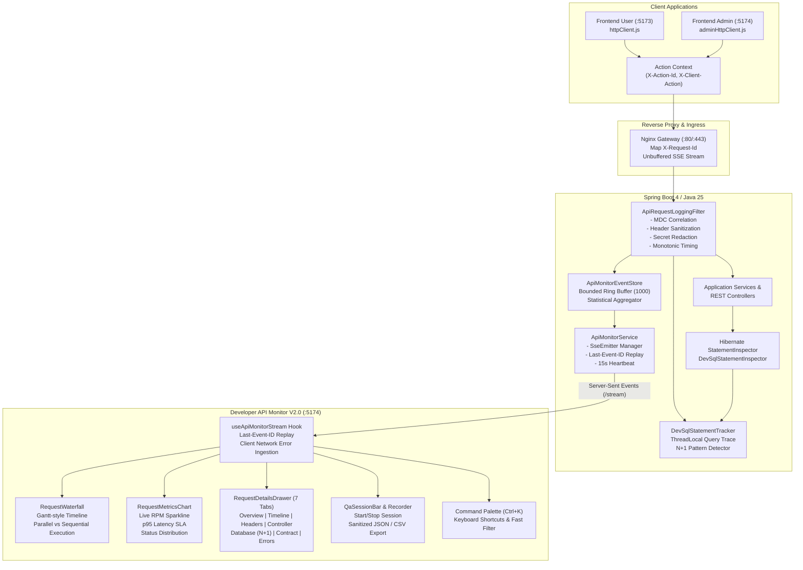

# Koupreng API Live Monitor V2.0 — Architecture & Request Tracing Specification

## 1. Executive Summary

**Koupreng API Live Monitor V2.0** is an interactive, real-time observability, tracing, and diagnostics platform for the Koupreng E-Invitation system. It allows developers, QA engineers, and administrators to observe genuine HTTP traffic, visualize request waterfalls grouped by user journeys, detect N+1 database queries in development, validate requests against the official OpenAPI specification, and record sanitized QA test sessions without exposing confidential secrets or tokens.

Target URL: `http://localhost:5174/dev/api-monitor`

---

## 2. End-to-End Tracing Architecture



---

## 3. Diagnostic Header & Correlation Protocol

Every HTTP request dispatched by `httpClient.js` or `adminHttpClient.js` automatically carries the following structured metadata headers:

| Header | Format / Example | Description |
| :--- | :--- | :--- |
| `X-Request-Id` | `[A-Za-z0-9._-]{8,100}` (e.g. `req-12345-abcde`) | Per-request correlation ID tracked across client, Nginx, and SLF4J MDC. |
| `X-Action-Id` | `[A-Za-z0-9._-]{1,64}` (e.g. `act-m1n4x8-abc`) | Groups multiple sequential or parallel HTTP calls belonging to a single user journey (e.g. `CREATE_INVITATION`, `REGISTER_SUBMIT`). |
| `X-Client-App` | `frontend-user` \| `frontend-admin` | Identifies the originating client application. |
| `X-Frontend-Route` | `[A-Za-z0-9._/~-]{1,100}` (e.g. `/register`, `/templates`) | Current SPA client route pathname. |
| `X-Client-Action` | `[A-Za-z0-9._-]{1,50}` (e.g. `LOGIN_SUBMIT`, `RSVP_SUBMIT`) | High-level semantic action metadata. |
| `X-Client-Duration-Ms` | Numeric (e.g. `48`) | Client-measured latency enabling calculation of network overhead delta. |
| `Last-Event-ID` | Numeric (e.g. `42`) | SSE reconnection pointer enabling zero-loss telemetry replay. |

### CORS Configuration
In both development (`application.properties`) and production (`application-prod.properties`), `ApiSecurityProperties` explicitly configures:
- **Allowed Headers:** `Authorization`, `Content-Type`, `X-Requested-With`, `X-Request-Id`, `X-Action-Id`, `X-Client-Duration-Ms`, `Last-Event-ID`, `X-XSRF-TOKEN`, `X-Frontend-Route`, `X-Client-Action`, `X-Client-App`.
- **Exposed Headers:** `X-Request-Id`, `X-Action-Id`, `X-XSRF-TOKEN`.

---

## 4. Server-Sent Events Hardening & Reconnection Replay

1. **Event IDs (`id:`):**
   Every SSE event dispatched by `ApiMonitorService` includes a monotonic identifier:
   ```text
   id: 42
   event: request
   data: {"id": 42, "requestId": "req-...", ...}
   ```
2. **Reconnection Replay:**
   When a client reconnects after network blip, it passes `Last-Event-ID: 42` (as an HTTP header or query parameter `?lastEventId=42`). `ApiMonitorService` retrieves missed events from `eventStore.getEventsAfter(42, 200)` and streams them immediately in the initial handshake payload with `replayed: true`.
3. **Heartbeat:**
   A scheduled 15-second ping (`event: ping`) keeps the connection alive across reverse proxies, Cloudflare tunnels, and browser timeouts.
4. **Non-blocking Broadcast:**
   SSE emitters use `CopyOnWriteArrayList` and dead emitter cleanup on send failure, ensuring no locking of HTTP worker threads.

---

## 5. Development SQL Diagnostics & N+1 Query Detection

1. **Hibernate Statement Inspector:**
   Registered in `application.properties` via `spring.jpa.properties.hibernate.session_factory.statement_inspector=com.koupreng.backend.devmonitor.infrastructure.DevSqlStatementInspector`.
2. **ThreadLocal Tracer (`DevSqlStatementTracker`):**
   - Initialized at request boundary in `ApiRequestLoggingFilter.doFilterInternal()`.
   - Records each executed SQL statement, query count, and execution duration.
   - Normalizes queries (replacing numeric literals and strings with placeholders `?`).
   - If the same normalized query is executed 3 or more times within a single request, flags `nPlusOneDetected = true`.
3. **Multi-Tab Inspector Database Tab:**
   Visualizes total queries, database execution time, and provides specific JPA refactoring guidance (e.g. `JOIN FETCH`, `@EntityGraph`, or `default_batch_fetch_size`).

---

## 6. OpenAPI Contract Validation

1. **Contract Source:**
   Extracted from the canonical API contract at `packages/api-contracts/openapi.yaml` into `apps/frontend-admin/src/features/api-monitor/openapiContractManifest.json` (238 endpoints).
2. **Validator Engine (`apiContractValidator.js`):**
   - Matches observed request method and path against compiled route regular expressions.
   - Classifies every request:
     - `MATCHED`: Official versioned endpoint (e.g. `POST /api/v1/auth/login`).
     - `COMPATIBILITY_ALIAS`: Legacy unversioned endpoint (e.g. `POST /api/auth/login`), providing an upgrade notice.
     - `UNMATCHED`: Unrecognized or untracked URL.
   - Renders color-coded badges in both the Live Request Table and the Request Details Drawer.

---

## 7. QA Session Recording & Sanitized Export

1. **Session Recorder Hook (`useQaSessionRecorder.js`):**
   - Allows QA engineers to start an exploratory testing session with a name (e.g. "Public RSVP Flow Test").
   - Add timestamped notes at key test steps.
   - Visual pulsing recording indicator in `QaSessionBar.jsx`.
2. **Strict Zero-Secret Sanitization:**
   - Query string parameters are sanitized at the server: passwords, tokens, API keys, and authorization codes are masked as `[REDACTED]`.
   - Export payloads (JSON and CSV) contain ONLY request metadata, timing, and status codes.
   - Zero passwords, zero Bearer tokens, zero cookie values, and zero sensitive request bodies are ever persisted or exported.

---

## 8. Interactive Request Waterfall & Live Metrics

1. **Request Waterfall (`RequestWaterfall.jsx`):**
   - Visual Gantt-style timeline displaying the last 40 requests.
   - Group by Action ID: correlates requests triggered within the same workflow.
   - Distinguishes parallel execution (overlapping timebars) from sequential execution.
   - Color codes by status (2xx emerald, 4xx amber, 5xx rose).
   - Click to inspect: opens the multi-tab Request Inspector.
2. **SVG Telemetry Charts (`RequestMetricsChart.jsx`):**
   - **Velocity:** Live Requests Per Minute (RPM) smooth area sparkline.
   - **Latency SLA:** Average duration and p95 percentile vs 500ms threshold.
   - **Status Distribution:** Stacked percentage bar for 2xx, 4xx, and 5xx outcomes.
3. **Command Palette (`ApiMonitorCommandPalette.jsx`):**
   - Triggered via `Ctrl+K` or `Cmd+K`.
   - Keyboard shortcuts for Live/Pause, Clear, Filter User/Admin, Filter Errors/Slow, Waterfall View, and Data Export.

---

## 9. Production Safety Invariants

- **Default Disabled:** `app.dev-monitor.enabled=false` by default in `application-prod.properties`.
- **Zero Overhead:** When disabled, `ApiRequestLoggingFilter` skips recording with zero allocations, `DevSqlStatementTracker` does not trace, and `/stream` returns `403 FORBIDDEN`.
- **Clean Architecture Boundary:** ArchUnit tests (`ArchitectureRulesTests.java`) verify that all monitoring controllers live in `*.api.*`, return immutable DTOs, and do not access persistence directly.
- **Role Protection:** Secured under `@PreAuthorize("hasRole('ADMIN')")`.

