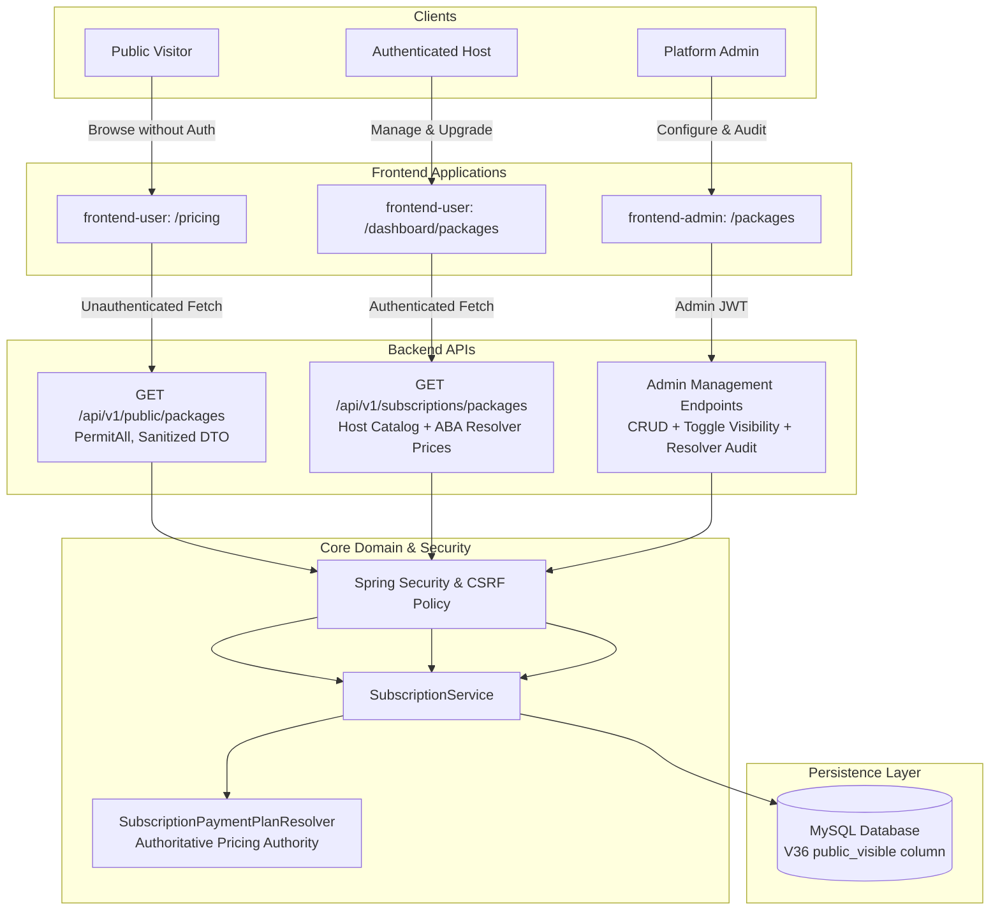
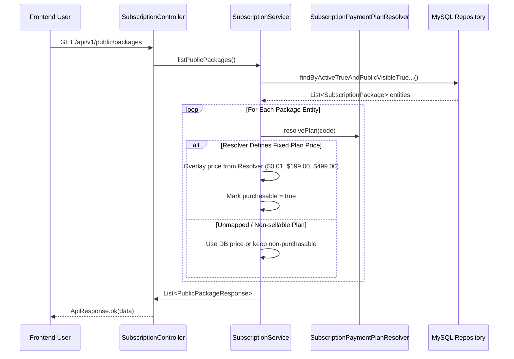

# Koupreng V8 Pricing & Subscription Architecture

## 1. System Overview

The V8 Pricing & Subscription architecture establishes a clear separation of concerns across public visitors, authenticated hosts (couples/wedding organizers), and platform administrators:

---

## 2. Public vs Authenticated Boundary

### 2.1 Public Endpoint (`GET /api/v1/public/packages`)
- **Accessibility:** Publicly accessible via `SecurityConfig` without authentication tokens or cookies.
- **CSRF Strategy:** Whitelisted in `CSRF_PUBLIC_PATHS` (`/api/v1/public/**`).
- **Data Filtering:**
  - Database queries only fetch rows where `active = true` AND `public_visible = true`.
  - Excludes internal and developmental package codes (e.g., `DEV_STARTER`, `TEST_*`).
- **DTO Exposure:** Returns `PublicPackageResponse`:
  - Strips internal administrative metadata, created/updated timestamps, and sensitive operational IDs.
  - Exposes `code`, `name`, `description`, `price` (mapped from `SubscriptionPaymentPlanResolver`), `currency`, `billingCycle`, `durationDays`, `invitationLimit`, `guestLimit`, `features`, `sortOrder`, and `purchasable`.
  - ArchUnit boundaries are preserved: controllers never expose JPA entities.

### 2.2 Host Endpoint (`GET /api/v1/subscriptions/packages`)
- **Accessibility:** Requires `ROLE_USER` or `ROLE_ADMIN` authentication.
- **Capabilities:** Lists active packages eligible for host subscription checkout.
- **Price Authority:** Dynamic prices from the database are superseded by `SubscriptionPaymentPlanResolver` to guarantee exact match with static ABA PayWay checkout constraints.

### 2.3 Admin Package Management (`/api/v1/admin/packages/**`)
- **Accessibility:** Requires `ROLE_ADMIN` authentication.
- **Capabilities:**
  - View all packages (active, inactive, public, unlisted).
  - Toggle publication status via `PATCH /api/v1/admin/packages/{packageId}/toggle-visibility`.
  - Inspect mismatch warnings between database price records and static ABA payment resolver pricing.

---

## 3. Database Schema & Flyway Migration

### Flyway Migration: `V36__add_public_visible_to_packages.sql`
- **Engine:** MySQL 8.0 with `utf8mb4_unicode_ci`.
- **Column:** `public_visible BOOLEAN NOT NULL DEFAULT FALSE` on table `packages`.
- **Index:** `idx_packages_public_visible (public_visible)` for sub-millisecond public query execution.
- **Initial State Migration:**
  - `BASIC`, `PRO`, `PREMIUM` are set to `public_visible = TRUE`.
  - Internal or seed packages (such as `DEV_STARTER`) retain `public_visible = FALSE`.
- **Forward-Only Contract:** Does not alter previous migrations `V1` through `V35`.

---

## 4. Authoritative Pricing Architecture

- **Inviolable Price Invariant:** Browser-submitted or stale database prices must never dictate payment amounts.
- **ABA PayWay Gateway Hardcoding:** `SubscriptionPaymentPlanResolver` statically verifies the ABA PayWay merchant package tier:
  - `BASIC`: `$0.01` USD (Production testing / minimal entry tier)
  - `PRO`: `$199.00` USD (Full wedding tier)
  - `PREMIUM`: `$499.00` USD (VIP wedding / concierge tier)
- Stale database records or mismatched administrative inputs generate UI warnings in Admin and are automatically normalized at the application service boundary.

---

## 5. Security & Defensive Invariants

1. **IDOR & Entitlement Protection:** Non-admin users cannot initiate checkout on unpublished (`public_visible = false`) packages, even if they guess the package code or identifier.
2. **Strict Regex Validation on ABA Transaction Suffix:** Host checkout enforces `^\d{3}$` (exactly 3 numeric digits) for manual ABA bank transfer reconciliation.
3. **Clean Architecture Boundaries:** Verified via ArchUnit tests (`ArchitectureRulesTests`). DTOs, controllers, services, and domain entities adhere to strict layering invariants without circular dependencies.

