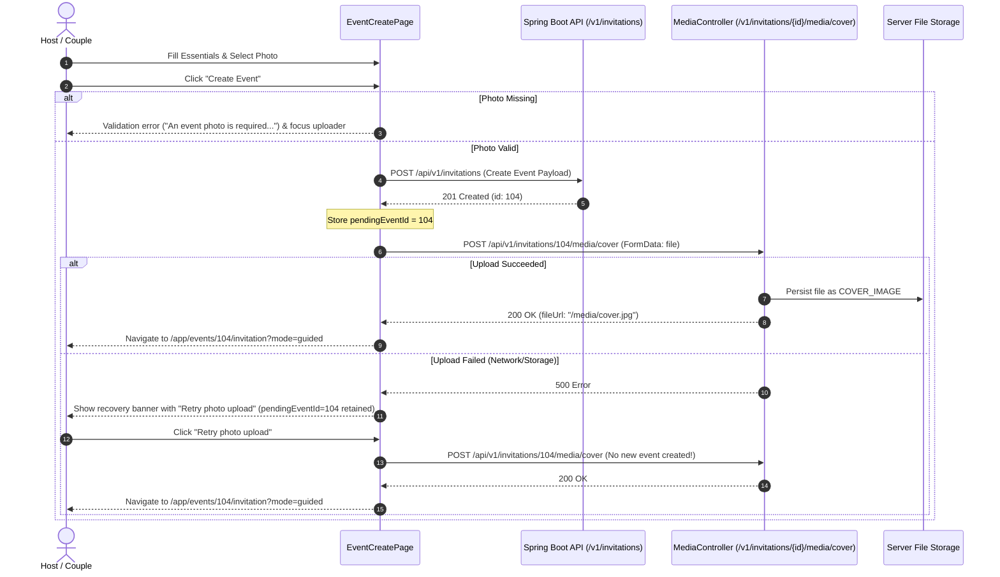

# Event Photo Selection & Two-Stage Upload Architecture

## 1. Problem Statement & Design Requirements

In prior phases, event creation created an invitation record, but did not require an event or couple photo at onboarding time. Users had to independently navigate to the studio or media manager to upload a photo, leading to unpersonalized event cards and empty dashboard headers.

Phase 07 introduces a mandatory event photo selection step in the mobile-first wizard (`/app/events/new`, Step 2: Event Essentials) with the following design principles:
1. **Contextual Event-Type Semantics:**
   - `WEDDING`: "រូបថតគូស្វាមីភរិយា" (Couple Photo)
   - `ENGAGEMENT`: "រូបថតគូដណ្ដឹង" (Couple Photo)
   - `BIRTHDAY`: "រូបថតម្ចាស់ខួបកំណើត" (Celebrant Photo)
   - `ANNIVERSARY`: "រូបថតគូស្វាមីភរិយា ឬការប្រារព្ធ" (Celebration Photo)
   - `CORPORATE`: "រូបថតស្ថាប័ន ឬកម្មវិធី" (Event / Organization Photo)
   - `OTHER`: "រូបថតគម្របកម្មវិធី" (Event Cover Photo)
2. **Client-Side Validation:**
   - Supported MIME types: `image/jpeg`, `image/png`, `image/webp`.
   - File size ceiling: 5 MB (5,242,880 bytes).
   - HEIC / HEIF prevention: Immediate user warning advising conversion to JPG/PNG/WebP.
3. **Focal Point Alignment:**
   - Options: `top`, `center`, `bottom`.
   - Live visual preview reflecting selected object-position.
4. **Idempotent Sequential Submission:**
   - Step 1: `invitationService.create(payload)` returns `event.id`.
   - Step 2: `mediaService.uploadCover(event.id, photoFile)` uploads photo multipart form.
   - Fault Tolerance: If Step 2 fails, `event.id` is retained in `pendingEventId`. Retrying only calls Step 2 without creating duplicate events.
5. **Partial Draft Permissibility:**
   - If user chooses "Save Draft" (`mode === "draft"`), photo is optional.

---

## 2. Component Design: `EventPhotoUpload.jsx`

`EventPhotoUpload.jsx` is located at `apps/frontend-user/src/features/events/onboarding/EventPhotoUpload.jsx`.

### Props Interface:
```typescript
interface EventPhotoUploadProps {
  previewUrl: string | null;
  focalPoint?: "top" | "center" | "bottom";
  eventType?: string;
  onFileChange: (file: File, previewUrl: string) => void;
  onFocalPointChange?: (point: "top" | "center" | "bottom") => void;
  onRemove: () => void;
  error?: string;
  required?: boolean;
  disabled?: boolean;
  en?: boolean;
}
```

### Drag-and-Drop & File Picker Integration:
The dropzone supports:
- Dragover, dragleave, drop handlers with visual styling (`.is-dragover`).
- Hidden `<input type="file" accept="image/jpeg,image/png,image/webp" />`.
- Keyboard activation (`Enter` / `Space`) on accessible dropzone role button.

### Memory Lifecycle Management:
`EventCreatePage.jsx` ensures memory safety by tracking blob URLs:
```javascript
useEffect(() => {
  return () => {
    if (photoPreviewUrl && photoPreviewUrl.startsWith("blob:")) {
      URL.revokeObjectURL(photoPreviewUrl);
    }
  };
}, [photoPreviewUrl]);
```

---

## 3. Sequential Creation Sequence Flow



---

## 4. Verification Evidence

1. **Unit Test Suite:** `apps/frontend-user/src/features/events/onboarding/RequiredPhotoEventCreation.test.jsx`
   - Test 1: Blocks event creation when photo is omitted with error message and Step 2 navigation.
   - Test 2: Permits partial draft saving without a photo.
   - Test 3: Executes two-stage sequential create-and-upload when photo is provided.
   - Test 4: Handles cover upload failure gracefully and retries without duplicate event creation.
2. **Component Test Suite:** `apps/frontend-user/src/features/events/onboarding/EventPhotoUpload.test.jsx`
   - Validates file format and 5MB size limit.
   - Validates HEIC conversion warning.
   - Validates focal point selection controls.
   - Validates remove and replace interactions.
