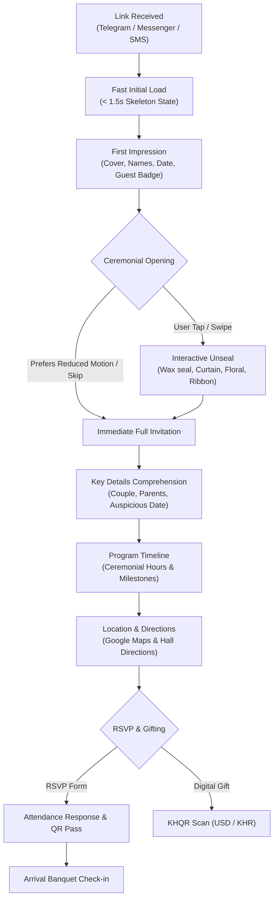

# Public Guest Journey Audit & UX Friction Analysis

## 1. End-to-End Guest Journey

---

## 2. Step-by-Step Stage Analysis

### Stage 1: Link Reception & Loading
- **Context:** Guests typically receive links in mobile messaging apps (Telegram, Messenger, WhatsApp) over 3G/4G cellular networks.
- **Optimization:** Clean URL paths (`/w/:slug` or `/i/:slug`), secure guest tokens (`?token=...`), and an instant high-performance skeleton loader prevent blank-screen anxiety.
- **Metric Target:** First Contentful Paint (FCP) $< 1.2\text{s}$, Cumulative Layout Shift (CLS) $< 0.05$.

### Stage 2: First Impression & Ceremonial Cover
- **Visuals:** High-resolution portrait or traditional artwork framed with Khmer gold foil borders.
- **Personalization:** When an invite token is present, the cover highlights the recipient's name ("ជូនចំពោះ: លោកអ្នក និងក្រុមគ្រួសារ" or specific guest name) and table assignment pill.
- **Accessibility:** High-contrast text guarantees readability in outdoor daylight conditions.

### Stage 3: Ceremonial Opening Interaction
- **Choreography:** Guests initiate the unsealing through an intuitive tap or swipe. Supported styles include:
  - *Envelope 3D / Wax Seal:* 3D wax seal break and letter slide (`DigitalYes`).
  - *Theatrical Velvet Curtain:* Smooth curtain parting with golden spotlight (`EmeraldLuxe`).
  - *Floral Gold Unfolding:* Golden archway flower reveal (`KhmerFloralGold`).
  - *Ribbon Untie:* Silk ribbon split (`RibbonOpening`).
  - *Direct Access:* Instant view for users with `prefers-reduced-motion: reduce`.
- **Skip Control:** A prominent "រំលង / Skip" button ensures guests can bypass animations if they need immediate access to event times or directions.

### Stage 4: Information Comprehension & Program Timeline
- **Core Answers:** Guests instantly find:
  - **Who:** Couple names and honored parents.
  - **When:** Calendar date, countdown, and ceremony times (Morning Buddhist blessing vs. Evening banquet).
  - **Where:** Venue name, building/hall details, and parking notes.
- **Timeline:** Structured visual timeline with Cambodian cultural icons (Water blessing, Hair cutting ceremony, Monk chanting, Evening reception).

### Stage 5: Venue Map & Google Maps Navigation
- **Security:** External map URLs are validated through `safeDirections` to prevent open-redirect vulnerabilities.
- **Clarity:** Integrates illustrative hand-drawn venue sketch maps alongside one-tap Google Maps navigation buttons.

### Stage 6: Public RSVP & Check-in Pass
- **Simplicity:** Single-screen form with big $\ge 44\text{px}$ touch targets.
- **Feedback:** Upon submission, guests receive an instant confirmation card with an embedded check-in QR code, table number, and seat assignment.
- **Wish Wall:** Guests can leave congratulatory blessings that appear in the public wish stream.

---

## 3. UX Laws & Principles Applied

1. **Fitts's Law:** Critical primary actions ("Open Invitation", "View Google Maps", "Submit RSVP") feature large, full-width touch areas placed in natural mobile thumb zones.
2. **Hick's Law:** Form options are streamlined. Attendance choice is limited to three clear options (`Attending`, `Not Attending`, `Maybe`) with a numeric guest stepper.
3. **Jakob's Law:** Map links, audio controls, and date cards utilize universally recognized iconography (pin, speaker, calendar) so guests do not require onboarding.
4. **Progressive Disclosure:** Complex details (table assignments, dietary notes, FAQ, dress code colors) are revealed through clean cards rather than overwhelming the first screen.
5. **Nielsen's Heuristic #3 (User Control & Freedom):** Always provide a visible "Skip" button during opening animations and a visible "Replay" button after completion.
