# Payment Architecture & Dual-Ledger Flow

## 1. System Overview

Koupreng's payment architecture is intentionally tailored for Cambodia's digital commerce landscape, prioritizing cost-efficiency, absolute data integrity, and strict separation between platform revenues and host wedding gifts.

```text
                                  ┌───────────────────────────────┐
                                  │      Koupreng Frontend        │
                                  │ (User App / Admin Workspace)  │
                                  └───────────────┬───────────────┘
                                                  │
                       REST / HTTPS (JWT Auth)   │
                                                  ▼
                                  ┌───────────────────────────────┐
                                  │      Spring Boot Backend      │
                                  │  - TemplatePaymentService     │
                                  │  - SubscriptionService        │
                                  │  - PaymentEvidenceService     │
                                  │  - WeddingGiftService         │
                                  └──────┬─────────────────▲──────┘
                                         │                 │
                Pessimistic Locking / DB │                 │ Internal Webhook
                  (SELECT ... FOR UPDATE)│                 │ (X-Admin-Payment-Secret)
                                         ▼                 │
┌───────────────────────────────┐ ┌──────────────┐         │
│     MySQL 8.0 Persistence     │ │ ABA PayWay   │         │
│  - template_payment_orders    │ │ Static Link  │         │
│  - subscriptions              │ └──────┬───────┘         │
│  - payment_evidence           │        │                 │
│  - wedding_gifts (isolated!)  │        │ Bank Push Alert │
└───────────────────────────────┘        ▼                 │
                                  ┌──────────────┐         │
                                  │ ABA Bot /    │         │
                                  │ Channel Alert│         │
                                  └──────┬───────┘         │
                                         │ Push Update     │
                                         ▼                 │
                                  ┌────────────────────────┴──────┐
                                  │   Python Telegram Worker      │
                                  │  - Origin verification        │
                                  │  - Metadata extraction        │
                                  │  - Replay / noise filter      │
                                  └───────────────────────────────┘
```

---

## 2. Dual-Ledger Isolation (Platform vs Guest Gifts)

One of Koupreng's most critical financial invariants is the absolute decoupling between Flow A (Platform Revenue) and Flow B (Guest Gifts):

| Dimension | Flow A: Platform Purchases | Flow B: Guest Wedding Contributions |
|---|---|---|
| **Payee** | Koupreng Platform Merchant Account | Event Host's Personal Bank / Cash Box |
| **Products** | Premium Templates, Subscription Tiers | Wedding cash gifts, congratulations envelopes |
| **Entitlement Impact** | Unlocks paid features upon settlement | **Zero digital entitlement impact** |
| **Checkout Mechanism** | Platform PayWay Static Links / QR | Host-uploaded Personal KHQR / Cash envelope |
| **Ledger Storage** | `template_payment_orders`, `subscriptions` | `wedding_gifts` (table strictly scoped by `invitation_id`) |
| **Accounting Rule** | Platform revenue audit trail | Host-only personal gift book; never platform income |
| **Bank Verification** | Verified against merchant alert bot / admin | Host-recorded manual entries ("Manual record") |

---

## 3. Order Lifecycle & State Machine

```mermaid
stateDiagram-v2
    [*] --> PENDING: User initiates checkout (Server-owned price & expiry)
    
    PENDING --> PAID_PENDING_REVIEW: Buyer submits claim (payer name, last 3)
    PENDING --> PAID_PENDING_REVIEW: Telegram alert detected (AutoConfirm=false)
    PENDING --> EXPIRED: Order session passes order_expires_at (30 mins)
    PENDING --> CANCELLED: User cancels order
    
    PAID_PENDING_REVIEW --> PAID: Authorized admin confirms with trusted transaction reference
    PAID_PENDING_REVIEW --> REJECTED: Evidence mismatch, duplicate, or fraud
    PAID_PENDING_REVIEW --> EXPIRED: Order expired prior to settlement attempt
    
    PAID --> [*]: Entitlements unlocked (Template access / Subscription active)
    EXPIRED --> [*]: Access remains locked; late payment routes to admin
    REJECTED --> [*]: Access remains locked
    CANCELLED --> [*]: Access remains locked
```



---

## 4. Cardinal Security Invariants

1. **Zero Browser Self-Approval:**
   Client input (payer name, claimed amount, uploaded slip, or last 3 account digits) is strictly untrusted claimant evidence. No order, template access, or subscription tier may be marked `PAID` or activated solely based on browser submissions.
2. **Server-Owned Prices:**
   Prices and currency rules are defined exclusively on the server in database catalogs (`TemplatePaymentOrder`, `SubscriptionTier`). The backend rejects any client request attempting to supply an arbitrary price.
3. **Replay & Cross-Order Prevention:**
   Every bank transaction ID (`payway_transaction_id`) is stored with a unique database constraint. An alert cannot be reused to confirm multiple orders.
4. **Currency Separation:**
   USD and KHR must never be conflated. An order priced at $5.00 USD cannot be settled by 5.00 KHR, and vice versa. Decimal-safe types (`BigDecimal` / `Decimal`) prevent floating-point rounding errors.
5. **No Blind Trust in Static Payment Links:**
   Because a static ABA payment QR/link does not carry dynamic order references into the bank's alert message, the system relies on multi-factor reconciliation (amount + currency + timestamp window + payer suffix + optional remark).
6. **Data Minimization:**
   Never store full bank account numbers, credit card CVVs, or unmasked sensitive PII. Only store the last 3 account digits (`payer_account_last3`), payer display name, and the official bank transaction reference.
7. **Pessimistic Row Locking:**
   When matching and settling an order, acquire a database row lock (`SELECT ... FOR UPDATE` via `LockModeType.PESSIMISTIC_WRITE`) on `TemplatePaymentOrder` and `Subscription` to prevent race conditions from concurrent webhook retries.
