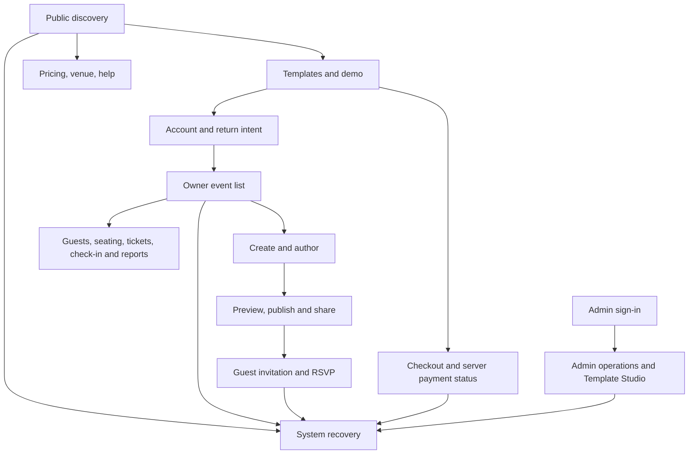

# Complete information architecture

The route matrix assigns every current URL to a shell and primary later phase. This is a **target navigation model**, not a router rewrite. Current URLs, aliases and backend guard decisions remain valid until a separately approved compatibility migration is tested.

## Shells and navigation

| Shell / current owner | Primary navigation | Contextual navigation and behavior |
|---|---|---|
| Public / `MarketingShell` | Home, Templates, Pricing, Venues, Contact | Catalog search/filter/sort, template detail/demo, entitlement-aware select; `/about` and `/help` aliases remain safe. |
| Account / `AuthShell` and account routes | Sign in, register, recovery | Preserve validated return URL; role-safe post-login route; expired/denied explanations; profile and packages in owner/account context. |
| Owner / `HostShell` | Event list, selected event overview, invitation, guests, operations, finance, settings/team | Event switcher changes event-scoped context explicitly; active event ID in URL is authoritative; task breadcrumbs and unsaved-draft guard. |
| Guest / dedicated renderers | Template-specific cover/content, event essentials, map, RSVP | No account chrome; accessible Skip, consent, private/expired handling; guest token never exposed across events. |
| Administrator / `AdminLayout` plus full-screen Studio | Dashboard, users, templates, packages, payments, notifications, reports, logs, API monitor | Studio five sections and preview device/gate controls; admin role guard and permission-aware destructive actions. |
| System / exception | 404, denied, offline, pending/review and interrupted return | Explain status, give safe retry/back/help, avoid false success and looped redirects. |

## Width and navigation contract

At 320–430px, show a labeled current destination and a reachable menu or bottom task navigation. Keep touch targets at least 24 CSS px for WCAG 2.2 exceptions and aim for 44px where practical; avoid hover-only disclosure. At 600–1023px use a compact task rail or drawer and one dominant work panel. At 1024px+ show persistent navigation with a contextual panel only when main task width remains usable. Short landscape needs independent scroll of dense authoring areas without hiding the only save/return path. Back goes to prior task context; breadcrumb goes to a stable ancestor; browser Back retains drafts or warns before loss.

For direct links, parse route parameters, then authenticate/authorize on the server-backed action. Store only a safe same-origin return path across sign-in; reject arbitrary external redirects. `/dashboard` and `/app` legacy aliases remain explicit. An invalid event ID shows an event-safe recovery rather than opening a different event. Switching event clears stale event-scoped filters and draft affordances only after a deliberate choice; unsaved edits are retained or warned. Locale and management appearance switch without route reset, loss of keyboard focus or mutation of invitation language.

## Content hierarchy and component ownership

Public catalog cards show template identity, preview and server-backed price/ownership before decoration. Owner overview puts event state, next task and required attention above metrics. Admin Studio uses five labeled sections, with Edit/Preview on narrow screens and explicit device and cover/full preview controls; advanced settings live under their task section. The user shells own navigation; shared primitives own field/feedback/focus behavior; template renderers own invitation composition; server owns authorization, payment and persisted status. `Modal`, feedback host and existing tokens should be consolidated semantically in Phases 03–04, not duplicated.

## Bilingual navigation and status glossary

| Meaning | Khmer UI proposal | English UI | Authority |
|---|---|---|---|
| Continue to next wizard step | បន្ត | Next | Local wizard step; current rendered Khmer source. |
| Edit / Preview | កែសម្រួល / មើលជាមុន | Edit / Preview | Studio panel state. |
| Open invitation preview in new tab | បើកគំរូសំបុត្រអញ្ជើញក្នុងផ្ទាំងថ្មី | Open template preview in a new tab | Current Studio accessible name; preview has no entitlement. |
| Draft / Save draft | ពង្រាង / រក្សាពង្រាង | Draft / Save draft | Persist only after server acknowledgment. |
| Publish / Published | ផ្សព្វផ្សាយ / បានផ្សព្វផ្សាយ | Publish / Published | Server publish state. |
| Pending / Under review / Paid / Failed | កំពុងរង់ចាំ / កំពុងពិនិត្យ / បានបង់ប្រាក់ / បរាជ័យ | Pending / Under review / Paid / Failed | Server order status; no local promotion to PAID. |

Khmer copy needs native-language review before rollout; do not interpret these proposals as translation certification. Dates use event timezone and explicit day/month/year context; currency always includes USD/KHR code or unmistakable symbol and backend amount. Empty catalog, no owned template, 401, 403, 404, 409, 429, 503 and offline each provide a relevant return/retry route. Validation requires both route tests, guard tests, keyboard/touch/locale/width checks and measurement of navigation completion, as detailed in [handoff](16-phase-03-execution-handoff.md).
