# Ten end-to-end user journey blueprints

These are **proposed interaction contracts** grounded in current routes, Phase 01 audit and the Phase 02 source/fixture investigation. A route or mocked fixture does not prove live persistence, provider settlement or device behavior. Each flow names the next safe state after denial or interruption. Every journey applies the cross-cutting exception matrix at the end of this file.

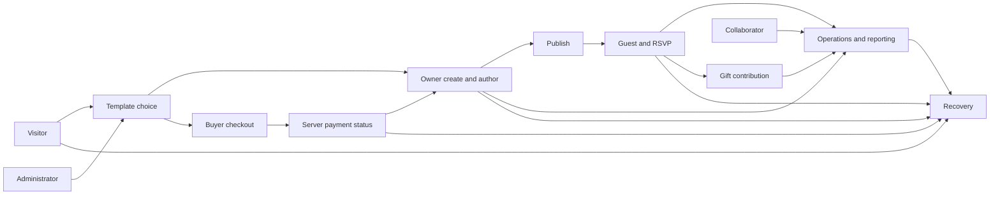

## J-01 — Visitor and template explorer

**Persona, intent, urgency, constraints, trust risk, priority:** First-time couple comparing invitations; exploratory but time-sensitive; phone, uncertain price and language. Trust risk: inaccurate previews or ownership promises. P1. **Baseline evidence:** SOURCE-MAPPED catalog/demo/auth routes; Phase 01 route smoke only.

**Entry, aliases, preconditions and permissions:** `/` → `/templates` → `/templates/:id` or `/templates/:id/demo`; `/templates/:id/preview` alias; public until selection, then authenticated purchase/create.

**Happy path, screens, CTAs and task owner:** Home: “Browse templates” → catalog search/filter and card “Preview” → bespoke demo “Open/Skip” → free “Use template” or premium “View price/checkout” → sign in if needed → return to the exact selected template and next valid action. The named user/guest/admin performs each CTA; the service confirms writes and protected status. Loading/disabled states keep the current context visible.

**Alternates, denial and recovery:** Empty catalog: explain no results and reset filters. Loading: skeleton with stable card geometry. 404 template: return to catalog. 401: preserve safe return URL. 403/unowned: explain purchase path without exposing editor. 429/503/offline: retry without losing filter or selection. Cancel checkout/sign-in: return to demo; duplicate select: one intent.

**Completion, persistence and resume:** Selected authorized template or deliberately exited to catalog. URL filters and chosen template survive refresh; hover and open-card state are ephemeral. Resume from same-origin intent only.

**Responsive, language and accessibility:** 320px card and filter drawer remain usable; tablet grid, desktop dense comparison; long Khmer names wrap; keyboard search/preview/use, visible focus, reduced-motion static demo, touch no hover dependency.

**Observable analytics proposal:** propose `template_search`, `template_preview_open`, `template_select_attempt`, `template_select_result`, `selection_resume`; no existing instrumentation assumed. **Truth source:** Catalog/price/owned flags and checkout eligibility from backend; preview never grants entitlement.

**Applied UX laws:** Hick: narrow filters reveal progressively; Jakob: search/filter/card behavior familiar; Fitts: obvious full-size Preview/Use targets; Nielsen visibility: owned vs premium status before selection.

**Before → after, dependency and acceptance:** Before: route-by-route discovery and sign-in handoff. After: explicit compare → preview → eligibility → preserved return intent. Phase 07–10/21; depends on server catalog and entitlement contract. Accept: free/premium/unowned/deleted templates, auth return, keyboard/touch, no misleading price.

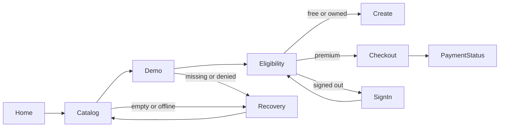

## J-02 — New event owner

**Persona, intent, urgency, constraints, trust risk, priority:** Couple creating a date-driven event, likely on a phone; may not have all details yet. Trust risk: lost draft or paid template intent. P1. **Baseline evidence:** SOURCE-MAPPED create/workspace/editor/publish routes; QA-NEW-01 action confirmed only in fictional fixture.

**Entry, aliases, preconditions and permissions:** `/app/events/new`; aliases `/create/wedding`, `/event/create`, `/dashboard/events/create`; authenticated save, entitlement checked by server.

**Happy path, screens, CTAs and task owner:** Choose event type/template → wizard step “បន្ត / Next” → enter title/date/timezone/venue → “Save draft” → event workspace → guided Studio “Edit” → “Preview” → review access → “Publish” → “Copy/share link”. The named user/guest/admin performs each CTA; the service confirms writes and protected status. Loading/disabled states keep the current context visible.

**Alternates, denial and recovery:** Validation keeps entered values and focus; 401 renews session with draft retained; 403/quota/entitlement explains why save/publish is denied; 409 revision conflict offers compare/reload; 429/503/offline/timeout leaves unsent draft visible and retries idempotently; duplicate submit disables or dedupes; Back/cancel warns on unsaved data; partial completion resumes draft.

**Completion, persistence and resume:** Server acknowledges draft, then publish state and canonical share URL. Authored fields, template ID, revision and status persist; step/accordion state may be local. Refresh reloads acknowledged data; return intent goes to event workspace.

**Responsive, language and accessibility:** One step per view with safe-area actions; tablet/desktop wider summary; long Khmer event names and diacritics; keyboard step navigation and errors, touch controls, screen-reader step/status announcement; reduced motion no wizard delay.

**Observable analytics proposal:** propose `event_create_start`, `wizard_step_complete`, `draft_save_attempt/result`, `publish_attempt/result`, `share_open` with no guest PII. **Truth source:** Event API owns event ID, save revision, template entitlement, publish state; client cannot infer successful save.

**Applied UX laws:** Error prevention: review date/timezone before publish; Nielsen user control: draft/back/cancel; progressive disclosure: advanced authoring follows essential fields.

**Before → after, dependency and acceptance:** Before: wizard and Studio are present but end-to-end persistence is unverified. After: explicit draft-safe sequence with state truth. Phase 11/13/15; depends on auth, event API and template entitlement. Accept: save/reload/conflict/offline/duplicate and share URL on isolated MySQL.

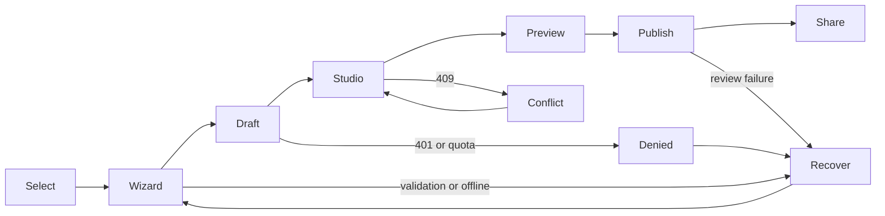

## J-03 — Returning event owner

**Persona, intent, urgency, constraints, trust risk, priority:** Owner updating a published invitation under time pressure; may switch events or devices. Trust risk: silent overwrite or unintended republish. P1. **Baseline evidence:** SOURCE-MAPPED event list and invitation/editor routes; persisted live roundtrip unverified.

**Entry, aliases, preconditions and permissions:** `/app/events` or deep link `/app/events/:eventId/invitation`; authenticated event permission required.

**Happy path, screens, CTAs and task owner:** Find event via list/search → open overview/status → “Edit invitation” → modify content/media → save with server revision → reload preview → review changed public content → “Publish/republish” when required. The named user/guest/admin performs each CTA; the service confirms writes and protected status. Loading/disabled states keep the current context visible.

**Alternates, denial and recovery:** Empty list offers create. 404 deleted event returns list. 403 revoked collaborator blocks edit without exposing data. 401 preserves safe link. 409 conflict shows server/current draft choices; offline/503/timeout retains local edits and explicit unsaved state; Back/event switch prompts save/discard; duplicate save avoids repeat; expired media gives replacement path.

**Completion, persistence and resume:** Saved revision and published state match server; guest view reflects intended version. Local unsaved draft is ephemeral until acknowledged; return to same event/task after session recovery.

**Responsive, language and accessibility:** Edit/Preview switch at phone widths, tablet single main pane, desktop split view; long Khmer text and focus restoration; touch/keyboard all sections and save; reduced motion no delayed save.

**Observable analytics proposal:** propose `event_open`, `editor_dirty`, `save_attempt/result`, `conflict_open/resolved`, `republish_result` without authored content. **Truth source:** Event/invitation API revision and ownership; preview session/origin checks; authored JSON remains roundtrip-safe.

**Applied UX laws:** Nielsen error recovery: preserve edits through conflict; consistency: same save/status language across owner/admin; Fitts: persistent save target on small screens.

**Before → after, dependency and acceptance:** Before: editor routes exist; refresh/conflict resilience not fully certified. After: visible revision/saved state and safe republish. Phase 12–15; depends on event API, preview trust and JSON contract. Accept: two-session conflict, unknown JSON, edit/preview/reload/publish parity.

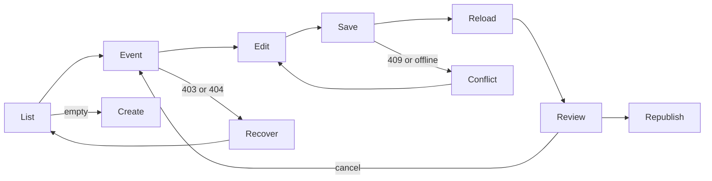

## J-04 — Invitation guest

**Persona, intent, urgency, constraints, trust risk, priority:** Invited guest opening a link in chat or in-app browser, often on mobile and limited bandwidth. Trust risk: private details leak or RSVP is falsely confirmed. P1. **Baseline evidence:** SOURCE-MAPPED `/w/:slug` and `/i/:slug`, renderer registry; real-device/provider state unverified.

**Entry, aliases, preconditions and permissions:** `/w/:slug` or `/i/:slug`, optional personalized token; public unless invitation policy requires password/token.

**Happy path, screens, CTAs and task owner:** Open link → choose “Open invitation” or “Skip opening” → read date/place/program → optional media consent → map/directions/calendar where supported → “RSVP” → review response → server confirmation and return link. The named user/guest/admin performs each CTA; the service confirms writes and protected status. Loading/disabled states keep the current context visible.

**Alternates, denial and recovery:** Invalid/expired/private token gives safe explanation without guest identity. Loading image/media shows text facts. Offline lets guest read cached facts only if already allowed and marks RSVP unsent. 429/503/timeout keeps response and retry; deadline/duplicate shows authoritative policy; refresh re-reads status. Audio denied/visibility pause does not block content. Cancel returns invitation.

**Completion, persistence and resume:** Server-confirmed RSVP or explicit unable-to-submit state; guest link and permitted response status persist, opening position/audio state are ephemeral. Resume only with valid same guest token.

**Responsive, language and accessibility:** 320px content hierarchy and safe-area RSVP; tablet/desktop maintain template composition; Khmer/English authored language independent of account locale; keyboard Skip/map/RSVP, touch stable hit areas, screen-reader landmark order; reduced motion static opening.

**Observable analytics proposal:** propose privacy-reviewed `invite_open`, `opening_skip`, `rsvp_attempt/result` without names/tokens in payload. **Truth source:** Invitation access, token, RSVP deadline and response from server; renderer controls do not create permissions.

**Applied UX laws:** Nielsen user control: skip/pause; Fitts: stable RSVP target; progressive disclosure: ceremonial detail after essentials; error prevention: review guest count before submit.

**Before → after, dependency and acceptance:** Before: bespoke renderers and RSVP paths exist, real in-app flow unverified. After: task-first guest path within each visual family. Phase 10/16/18; depends on renderer/access/API contract. Accept: all ten families, private/expired token, reduced motion, real iPhone/Android and in-app clients.

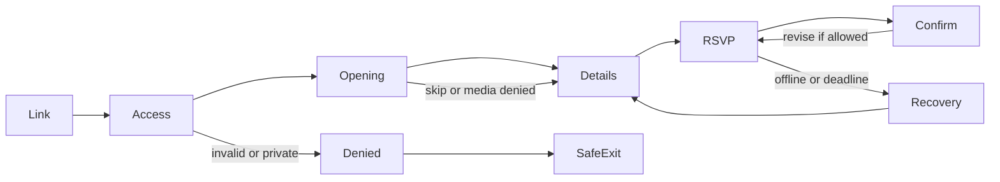

## J-05 — Operations user

**Persona, intent, urgency, constraints, trust risk, priority:** Owner or staff coordinating many guests, seating and admission; high volume, often on a tablet. Trust risk: wrong person seated/admitted. P1. **Baseline evidence:** SOURCE-MAPPED guests, RSVP, seating, ticket, QR, check-in and report routes; live import/scan not certified.

**Entry, aliases, preconditions and permissions:** `/app/events/:eventId/guests` from event workspace; event role/permission for each action.

**Happy path, screens, CTAs and task owner:** “Import guests” with preview/dedupe → review RSVP board → assign seats with capacity visible → design/export tickets and QR → staff check-in scan/manual lookup → attendance report. The named user/guest/admin performs each CTA; the service confirms writes and protected status. Loading/disabled states keep the current context visible.

**Alternates, denial and recovery:** Empty list invites manual add/import. Invalid CSV shows row errors. Duplicate import/scan resolves against server identity. 403 revocation stops mutation; 401 restores safe task. 409 capacity/revision conflict keeps selection and offers reassignment. Offline/503/timeout leaves unsent check-in clearly pending; 429 retry backoff. Back/cancel does not discard import preview; partial import reports exact accepted/rejected counts.

**Completion, persistence and resume:** Server guest IDs, seat assignments and check-in audit match displayed counts; filters/selection may be local. Resume at event and task with no duplicated import/check-in.

**Responsive, language and accessibility:** Phone list fallback to drag canvas, tablet operational layout, desktop bulk tools; long Khmer names and search; keyboard alternate for seating, scanner manual input, touch large targets, reduced motion no scan delay.

**Observable analytics proposal:** propose `guest_import_preview/result`, `seat_assignment_result`, `ticket_export`, `checkin_attempt/result` without raw guest data. **Truth source:** Guest/RSVP/seating/check-in APIs and event role; server is authority for capacity and duplicate admission.

**Applied UX laws:** Error prevention: preview import and capacity; Nielsen recognition: visible guest identity/status; Fitts: large scan/confirm controls; Gestalt: group guests by task/status.

**Before → after, dependency and acceptance:** Before: modules/routes exist, bulk/persistence proof incomplete. After: one event-scoped operational chain with explicit counts and safe alternatives. Phase 17–20/22; depends on role API and isolated data. Accept: dedupe, partial import, seat capacity, accessible assignment, invalid/duplicate QR and consistent report.

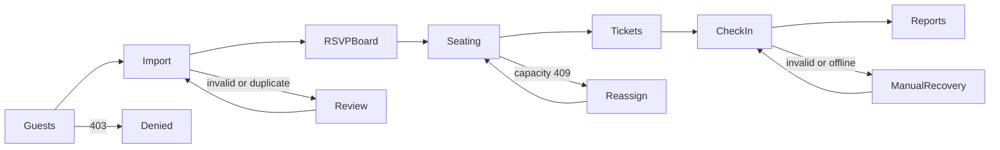

## J-06 — Premium template buyer

**Persona, intent, urgency, constraints, trust risk, priority:** Owner deciding to spend money on a template; may leave for ABA app. Trust risk: money or ownership misrepresented. P1. **Baseline evidence:** SOURCE-MAPPED checkout/payment status/return routes; provider settlement blocked.

**Entry, aliases, preconditions and permissions:** `/templates/:templateId/checkout`, `/payments/:orderCode/status`; `/payments/success`, `/payments/return`, `/payments/cancel` are callback/alias routes.

**Happy path, screens, CTAs and task owner:** Review server price/currency and entitlement → “Continue to payment” → server creates order/reference → show PENDING and provider handoff → return to status page → poll/refresh server verification → show PAID plus receipt/ownership only when server confirms. The named user/guest/admin performs each CTA; the service confirms writes and protected status. Loading/disabled states keep the current context visible.

**Alternates, denial and recovery:** Already owned avoids duplicate purchase. 401 returns to selected template. 403/invalid template blocks checkout. Duplicate submit reuses/idempotently resolves order. Provider cancel, expiry, 429/503/timeout or interrupted redirect lands on status lookup with reference. Review/failed statuses show next step without granting entitlement. Back keeps order code safely.

**Completion, persistence and resume:** PAID and owned only after server confirmation, or clear unresolved/failed/cancelled outcome. Order reference/status persist server-side; loading spinner is ephemeral. Resume via order-status URL without token leakage.

**Responsive, language and accessibility:** External app switch and in-app browser return, safe-area CTA, readable Khmer/English amount and USD/KHR, keyboard/touch provider link, no motion gating, accessible status updates.

**Observable analytics proposal:** propose `checkout_view`, `order_create_result`, `provider_handoff`, `status_refresh`, `verified_paid` with no secrets. **Truth source:** Order amount/currency/reference, settlement evidence, entitlement and receipt from backend; Telegram reconciliation is evidence input, not browser truth.

**Applied UX laws:** Nielsen visibility: PENDING means pending; error prevention: confirm amount before handoff; consistency: status vocabulary across return and history.

**Before → after, dependency and acceptance:** Before: payment routes exist; provider proof unverified. After: single truthful status model with recoverable return. Phase 09/21; depends on isolated MySQL, provider sandbox and replay-safe backend. Accept: pending/review/failed/expired/paid, duplicate callback, interrupted redirect and no premature entitlement.

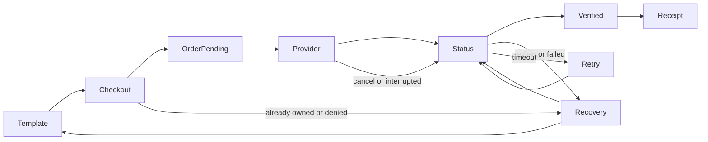

## J-07 — Gift contributor and event owner

**Persona, intent, urgency, constraints, trust risk, priority:** Guest contributing or owner recording cash/manual gifts; sensitive social and financial context. Trust risk: manual records mistaken for provider-verified payments. P1. **Baseline evidence:** SOURCE-MAPPED gifts, payment and budget/report routes; real provider evidence unverified.

**Entry, aliases, preconditions and permissions:** Guest invitation gift section or owner `/app/events/:eventId/gifts` and budget/report routes; permission differs by role.

**Happy path, screens, CTAs and task owner:** Guest sees approved gift options and recipient details → chooses manual acknowledgement or provider path if actually supported → owner records manual gift with explicit label → reports distinguish manual and verified contributions → recipient/privacy controls govern disclosure. The named user/guest/admin performs each CTA; the service confirms writes and protected status. Loading/disabled states keep the current context visible.

**Alternates, denial and recovery:** No gift option hides CTA gracefully. Private invite/403 denies details. Duplicate manual record prompts review. 409 edit conflict keeps notes. Offline/503/timeout leaves unsent entry; 429 retry. Provider PENDING/REVIEW/FAILED/EXPIRED never becomes “received.” Cancel returns invitation/owner list; wrong currency is blocked before save.

**Completion, persistence and resume:** Server-stored manual record or provider-verified payment shown with distinct provenance; entry and permission persist, form draft is ephemeral until acknowledged. Resume in appropriate guest/owner context.

**Responsive, language and accessibility:** Simple contribution choices on phone, owner list/table responsive, Khmer/English currency and privacy text, keyboard/touch and screen-reader status, reduced motion static.

**Observable analytics proposal:** propose `gift_option_view`, `manual_record_attempt/result`, `verified_gift_status_view` without donor amount/name unless approved. **Truth source:** Owner gift API for manual records; payment/reconciliation API only for verified settlement. Recipient data/access checked server-side.

**Applied UX laws:** Error prevention: explicit provenance label; Nielsen match to real world: “recorded manually” vs “verified payment”; Gestalt: separate manual and verified totals.

**Before → after, dependency and acceptance:** Before: gift and financial routes coexist. After: provenance visibly separated end-to-end. Phase 21–22; depends on payment truth and privacy policy. Accept: mixed manual/verified cases, denied guest, duplicates, currency and report totals on isolated DB.

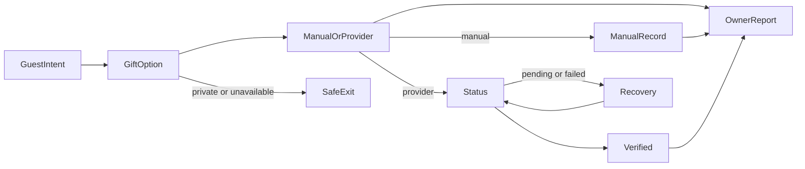

## J-08 — Administrator

**Persona, intent, urgency, constraints, trust risk, priority:** Authorized operator maintaining users/templates/payments; dense work and audit responsibility. Trust risk: unsafe role or payment mutation. P1. **Baseline evidence:** SOURCE-MAPPED 24 admin leaves; Studio preview link action confirmed in engine fixtures; live CRUD unverified.

**Entry, aliases, preconditions and permissions:** Admin login → `/admin`/dashboard, template catalog and full-screen Studio; admin role guard required.

**Happy path, screens, CTAs and task owner:** Sign in → dashboard attention queue → templates list/create/edit → five-section Studio and device preview → save/publish if authorized → review users/packages/payments/notifications/reports/logs/API monitor → confirm destructive actions with audit context. The named user/guest/admin performs each CTA; the service confirms writes and protected status. Loading/disabled states keep the current context visible.

**Alternates, denial and recovery:** 401 session expiry returns safe admin task. 403 role denial shows no mutation controls. Empty list/search reset. 404 deleted record returns list. 409 concurrent edit retains form. 429/503/offline/timeout shows unsaved state and retry. Duplicate submit dedupes. Back/cancel warns. Preview error preserves editor and cannot become a public entitlement.

**Completion, persistence and resume:** Server confirms each mutation and audit log; filters and panel mode local, authored template JSON/revision persisted. Resume admin task after reauth only if role still valid.

**Responsive, language and accessibility:** 320/390 icon actions have accessible names; short landscape scroll keeps all controls reachable; tablet panel switch, desktop split resize; long Khmer wraps; keyboard all five sections/preview, touch controls, reduced motion static.

**Observable analytics proposal:** propose `admin_task_open`, `template_save_result`, `permission_denied`, `preview_open`, `admin_mutation_confirmed` without sensitive payload. **Truth source:** Admin API role and revision; template registry/preview origin; payment mutation only through server policy and audit.

**Applied UX laws:** Nielsen consistency and error prevention: statuses and confirmation; Fitts: reachable icon targets; progressive disclosure: five sections; user control: unsaved guard.

**Before → after, dependency and acceptance:** Before: broad admin routes and dense Studio exist, current three assertion gaps. After: role-safe task architecture and tested scroll/preview controls. Phase 24–25; depends on admin API and preview trust. Accept: guarded CRUD, five sections, 320–1440/landscape, keyboard, save/reload and cross-origin denial.

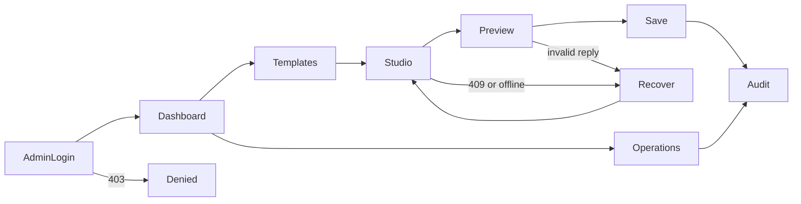

## J-09 — Organization collaborator

**Persona, intent, urgency, constraints, trust risk, priority:** Invited helper with narrower event scope; may accept from a deep link. Trust risk: stale access after revocation. P1. **Baseline evidence:** SOURCE-MAPPED organization, team and notification routes; live invitation/revoke not retested.

**Entry, aliases, preconditions and permissions:** Invitation deep link → organization/team route under `/app`; authenticated acceptance and event-scoped role.

**Happy path, screens, CTAs and task owner:** Open invitation → sign in/return if needed → view org/event and requested role → “Accept” or “Reject” → enter permitted task → team settings shows role → owner can revoke → next action rechecks access. The named user/guest/admin performs each CTA; the service confirms writes and protected status. Loading/disabled states keep the current context visible.

**Alternates, denial and recovery:** Expired/invalid invitation gives safe owner contact route. 401 preserves same-origin intent. 403/revoked blocks data and clears stale event context. 404 org deleted returns event list. Duplicate accept is idempotent. 409 role changed prompts review. Offline/429/503/timeout keeps invitation pending, not accepted. Cancel returns account; back does not grant role.

**Completion, persistence and resume:** Server membership accepted/rejected/revoked and effective permissions confirmed; selected event UI state local. Resume only while server still authorizes membership.

**Responsive, language and accessibility:** Clear role summary and accept/reject targets on phone; tablet/desktop role matrix; long Khmer organization names, keyboard/touch, focus and reduced-motion support.

**Observable analytics proposal:** propose `invite_view`, `invite_accept_result`, `role_denied`, `membership_revoked_view` without invite token. **Truth source:** Organization/team membership and event permissions from backend on every action; local role cache is insufficient.

**Applied UX laws:** Error prevention: summarize role before accept; Nielsen system status: invitation vs member; consistency: permission error wording across owner/admin.

**Before → after, dependency and acceptance:** Before: routes present, current revocation semantics unverified. After: explicit invite lifecycle and truthful capability affordances. Phase 23; depends on auth and organization API. Accept: invite/expire/reject/accept/revoke/deep-link across two sessions.

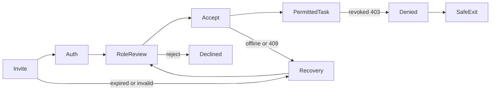

## J-10 — Exceptional entry and interrupted work

**Persona, intent, urgency, constraints, trust risk, priority:** Any user arriving from a stale link, offline session, revoked role or interrupted redirect. Urgency varies; trust risk: silent data loss or false success. P1 cross-cutting. **Baseline evidence:** SOURCE-MAPPED wildcard/alias/status routes; failure states largely unverified outside targeted fixtures.

**Entry, aliases, preconditions and permissions:** Any deep link, including `*`, admin `*`, expired auth, private invitation, quota, failed upload, conflict, payment return; permissions route-specific.

**Happy path, screens, CTAs and task owner:** Detect actual condition → name the state plainly → preserve safe non-secret intent/draft/order reference → offer one primary recovery (retry, sign in, return, resolve conflict or contact) → revalidate server state → resume original permitted task. The named user/guest/admin performs each CTA; the service confirms writes and protected status. Loading/disabled states keep the current context visible.

**Alternates, denial and recovery:** 401 sign in; 403 safe exit or access request; 404 nearest valid parent; 409 compare/reload; 429 wait/retry; 503/offline keep draft pending; expiry/invalid token protect privacy; duplicate submit show existing result; upload failure retain selected metadata; interrupted payment redirects to order status; cancellation never implies success.

**Completion, persistence and resume:** User reaches a valid task or a truthful terminal denial with safe next step. Only server-acknowledged state persists; local draft/return intent has bounded lifetime and origin. Refresh and Back cannot silently mutate status.

**Responsive, language and accessibility:** Recovery text fits 320px and short landscape; keyboard focus moves to heading/alert and returns predictably; touch CTA remains in safe area; Khmer/English exact status; reduced-motion static feedback and screen-reader announcement.

**Observable analytics proposal:** propose `recovery_shown`, `recovery_action`, `recovery_success/failure` keyed by coarse error type, no tokens/PII. **Truth source:** HTTP status, backend authorization, save revision, order status and upload result; browser connectivity is only a signal.

**Applied UX laws:** Nielsen error recognition/recovery: plain cause and next step; user control: retry/cancel; error prevention: no optimistic PAID or duplicate writes.

**Before → after, dependency and acceptance:** Before: exceptions vary across routes. After: shared, domain-aware recovery contract. Phase 04/06/08/21/26; depends on backend status semantics and safe return-intent policy. Accept: 401/403/404/409/429/503/offline, duplicate, expiry, refresh, back and interrupted provider return across representative routes.

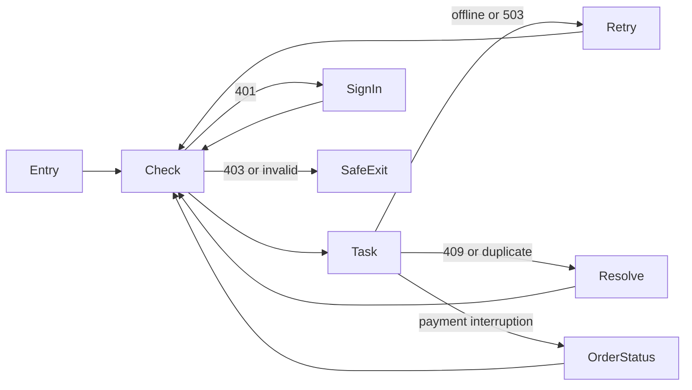

## Cross-journey exception and quality contract

| Condition | Visible response and recovery | Server/permission rule |
|---|---|---|
| Loading / empty | Explain progress or no results, retain task context and reset filters/create action. | Do not fabricate records. |
| Invalid input / disabled | Name field and correction; preserve entered values and accessible error focus. | Validate again on server. |
| 401 / expiry | Explain session expiry, preserve safe same-origin return, then revalidate. | No protected data before authorization. |
| 403 / revoked | Explain access denial and offer safe parent/contact. | Never reveal protected content or mutate. |
| 404 / invalid token | Explain unavailable without disclosing private guest or event details. | Token and resource lookup server-side. |
| 409 / duplicate | Show comparison or existing result; avoid silent overwrite or duplicate writes. | Revision/idempotency key authoritative. |
| 429 / 503 / timeout / offline | Show retry timing and unsent state; keep reversible draft locally when lawful. | Do not claim save/RSVP/payment success. |
| Back / cancel / refresh / interruption | Warn on unsaved edits; reload server truth; resume bounded safe intent. | Preserve role and data boundaries. |

Proposed analytics need consent/privacy review and must omit invitation tokens, payment secrets, raw guest data and authored private content. Each owning phase must test its journey with isolated real services before marking implementation complete.
