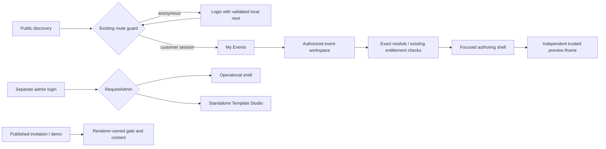

# 03 — implemented navigation architecture

Public discovery, authentication, owner/account, authorized event tasks, admin operations and guest art have distinct responsibilities. Existing route guards and server authorization still decide access. Menus expose destinations; they grant no permission. Breadcrumb event names come only from the verified EventWorkspace response. Admin parents are stable Workspace → current destination; owner parents are My Events → verified event → current module.

No route, alias, role guard, entitlement or event-switch implementation was replaced. Existing unsaved-history protection continues to govern Link/navigation operations. Explicit event-scoped module paths and exact active matching remain. `/dashboard`/`/app` compatibility and `/admin/*` aliases retain parameters/query intent according to their existing redirect rules.

The existing customer ScrollToTop owner now separates document titles from navigation. Locale changes retain scroll and typed state; query/filter updates retain focus. Back restores bounded, in-memory positions by history key. New destinations orient to a ready management main region, while existing user focus inside a field/table wins over late alias/API readiness. Guests keep their own scroll/focus choreography. No second router scroll restorer was installed.

The final zero-scroll probe found a new restoration regression: an entry at zero could leave before a scroll event or ready-page frame, so Back borrowed the next page's offset. The first attempt failed five of six engine/motion observations. Recording only at readiness still missed fast navigation. The final effect records the entry immediately and after orientation, with the same 100-entry bound. Six focused observations then passed with a real 300px catalog offset, and the permanent suite gained a 22nd case. See history-zero-first-failure.json, history-zero-ready-only-attempt.json and history-zero-results.json.
