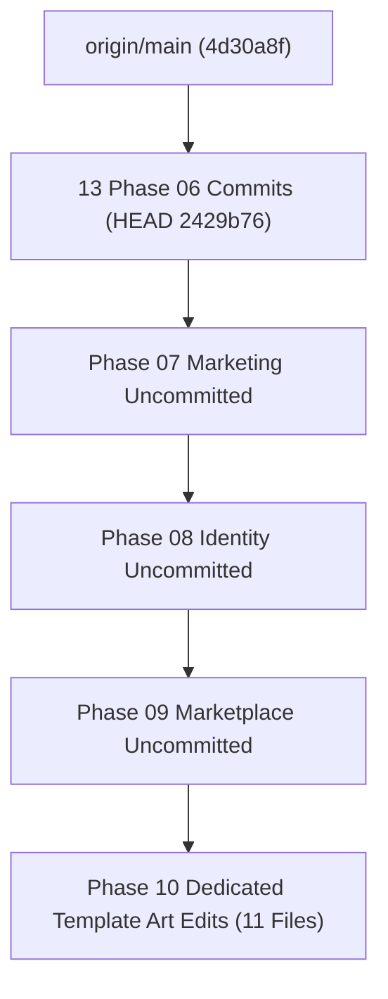

# KOUPRENG — PHASE 10.1: Git Baseline, Local Dirty Worktree Preservation & Attribution

**Execution Date:** 18 November 2026, Asia/Bangkok  
**Role:** Creative Director, Cambodian Wedding Art Director, React 19 Frontend Engineer  
**Audit Reference:** Phase 10.1 Dedicated Invitation Art, Renderer UX/UI & Frontend Execution  
**Status:** VERIFIED — LOCAL  

---

## 1. Baseline Fingerprints & Preservation Contract

The Phase 10.1 implementation operates under strict non-destructive git preservation invariants:
- **HEAD Commit:** `2429b76545b683fad2a0a6f328bee3264875edc3`
- **Upstream Tracking:** 13 commits ahead of `origin/main` (`4d30a8f3bd0b0c1ab63b9111389bfbeb6ece19b4`)
- **Preserved Commits:** Exactly 13 local Phase 06 commits retained intact
- **Preserved Dirty Worktrees:** All uncommitted modified and untracked files from Phase 07 (Marketing), Phase 08 (Identity & Auth), and Phase 09 (Template Marketplace & Pricing) preserved with zero mutation.
- **Git Invariants Enforced:** Zero `git commit`, zero `git push`, zero `git reset`, zero `git clean`, zero `git checkout`, zero `git stash`, and zero branch switches.

## 2. Phase 10 File Modification Attribution

The following 11 tracked files were modified to fulfill Phase 10.1 bespoke template art, accessibility, and opening choreography:
1. [TemplateBoilerplateLayout.jsx](file:///d:/Koupreng-invitation_project/apps/frontend-user/src/features/templates/layouts/TemplateBoilerplate/TemplateBoilerplateLayout.jsx) — Transformed mock template into production-grade accessible starter layout.
2. [template-boilerplate.css](file:///d:/Koupreng-invitation_project/apps/frontend-user/src/features/templates/layouts/TemplateBoilerplate/template-boilerplate.css) — Added responsive styles, skip button, and mobile 360px rules.
3. [WaxSealEnvelope.jsx](file:///d:/Koupreng-invitation_project/apps/frontend-user/src/features/templates/layouts/DigitalYes/components/WaxSealEnvelope.jsx) — Added accessible Skip opening button and keyboard Enter/Space controls.
4. [DigitalYesLayout.jsx](file:///d:/Koupreng-invitation_project/apps/frontend-user/src/features/templates/layouts/DigitalYes/DigitalYesLayout.jsx) — Integrated reduced motion bypass and Skip event handler.
5. [VelvetCurtainOpening.jsx](file:///d:/Koupreng-invitation_project/apps/frontend-user/src/features/templates/layouts/EmeraldLuxe/components/VelvetCurtainOpening.jsx) — Added Skip opening button and couple name clamp scaling.
6. [EmeraldLuxeLayout.jsx](file:///d:/Koupreng-invitation_project/apps/frontend-user/src/features/templates/layouts/EmeraldLuxe/EmeraldLuxeLayout.jsx) — Added instant reveal reduced motion bypass and Skip wiring.
7. [emerald-luxe.css](file:///d:/Koupreng-invitation_project/apps/frontend-user/src/features/templates/layouts/EmeraldLuxe/emerald-luxe.css) — Fixed 320px horizontal overflow and styled .el-skip-btn.
8. [CanvaKhmerWeddingTemplate.jsx](file:///d:/Koupreng-invitation_project/apps/frontend-user/src/features/templates/experience/components/canva-khmer/CanvaKhmerWeddingTemplate.jsx) — Added Skip opening button, previewStartClosed prop, and decoupled AnimatePresence mode.
9. [canva-khmer-wedding.css](file:///d:/Koupreng-invitation_project/apps/frontend-user/src/features/templates/experience/components/canva-khmer/canva-khmer-wedding.css) — Styled .ck-cover__skip with 44px min target.
10. [WithJoyPortalLayout.jsx](file:///d:/Koupreng-invitation_project/apps/frontend-user/src/features/templates/layouts/WithJoyPortalLayout.jsx) — Added role="dialog", Escape key listener, and normalized tpl prop.
11. [withjoy-portal.css](file:///d:/Koupreng-invitation_project/apps/frontend-user/src/features/templates/layouts/withjoy-portal.css) — Replaced display:none mobile nav with horizontal scroll pill bar.
