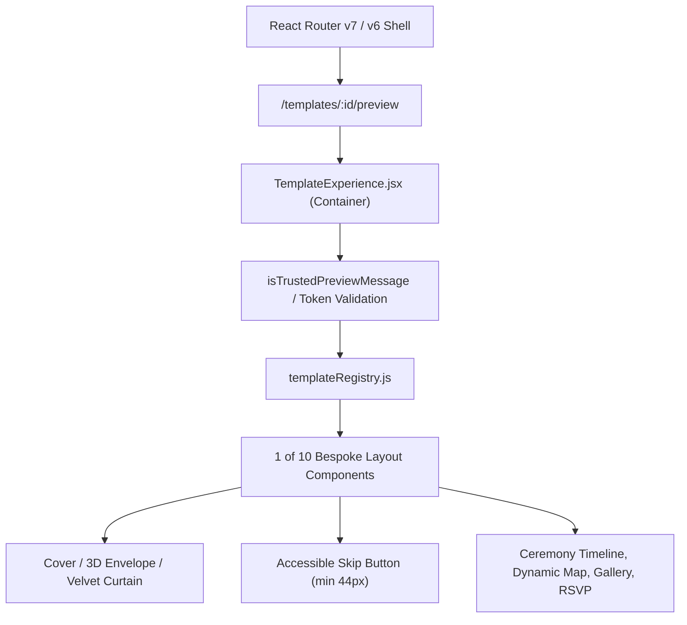

# KOUPRENG — PHASE 10.1: Source Route, State & Component Inventory

**Execution Date:** 18 November 2026, Asia/Bangkok  
**Role:** Creative Director, Cambodian Wedding Art Director, React 19 Frontend Engineer  
**Audit Reference:** Phase 10.1 Dedicated Invitation Art, Renderer UX/UI & Frontend Execution  
**Status:** VERIFIED — LOCAL  

---

## 1. Route Inventory & Authorization Surfaces

Phase 10.1 provides complete route, parameter, and state coverage across all template viewing surfaces:

| Route Pattern | Component Surface | Auth Requirement | Opening State Strategy |
| :--- | :--- | :--- | :--- |
| `/templates` | `BrowseTemplatesFeature` | Public | Marketplace Atelier Catalog |
| `/templates/browse` | `BrowseTemplatesFeature` | Host Session | Authenticated host management |
| `/templates/:templateCode/preview` | `TemplateExperience` | Public / Token | Starts with Cover / Gate unless bypassed |
| `/invitations/:slug` | `PublicInvitationPage` | Token / Public | Live guest invitation view |
| `/admin/templates/:id` | `AdminTemplateEditPage` | Admin Auth | Real-time simulator postMessage iframe |

## 2. Component Architecture Hierarchy

