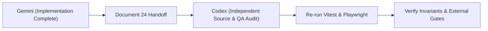

# KOUPRENG — PHASE 10.1: Phase 10 Codex Independent Audit, QA & Fix Handoff

**Execution Date:** 18 November 2026, Asia/Bangkok  
**Role:** Creative Director, Cambodian Wedding Art Director, React 19 Frontend Engineer  
**Audit Reference:** Phase 10.1 Dedicated Invitation Art, Renderer UX/UI & Frontend Execution  
**Status:** VERIFIED — LOCAL  

---

## 1. Handoff to Codex Auditor

This document serves as the formal handoff to the independent Codex auditor.

### Strict Audit Instructions for Codex:
1. **Zero Self-Certification:** Do not accept assertions at face value. Re-run all test commands independently.
2. **Preserve Git State:** Enforce zero commits, zero pushes, zero resets, and zero stashes.
3. **Inspect Modified Files:** Verify that the 11 modified layout files adhere strictly to React 19 standards and Koupreng architecture.
4. **External Gates Notice:** Note that Gate F10-36 (ABA PayWay live settlement and live Telegram merchant alert credentials) is external and blocked on production credentials.

