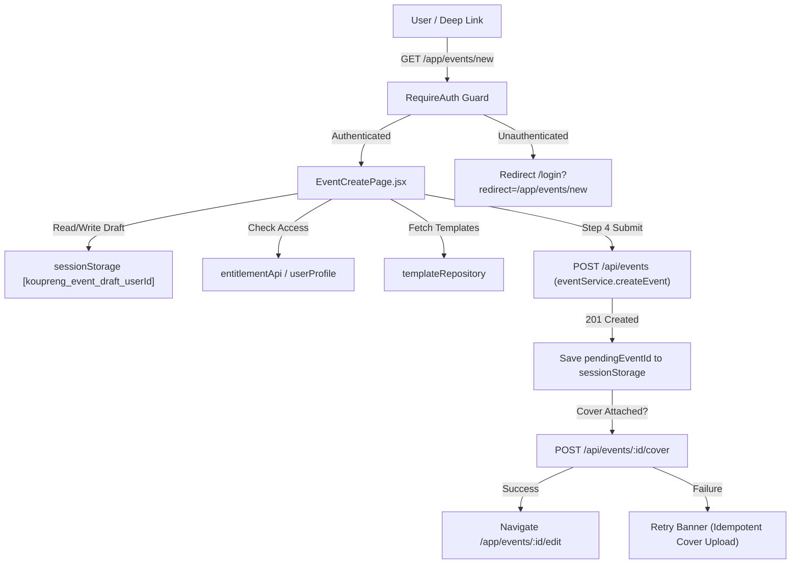

# 02 — Phase 11.1 Scope, Routes, and Source Contracts

**Phase:** `11.1`  
**Canonical Route:** `/app/events/new`  
**Component:** `apps/frontend-user/src/features/events/onboarding/EventCreatePage.jsx`

---

## 1. Route Topology and Guards

The Koupreng event creation experience is mapped across the following canonical routes and aliases:

| Route Path | Type | Guard / Wrapper | Purpose |
|---|---|---|---|
| `/app/events/new` | Canonical Route | `RequireAuth` | Four-step event onboarding and creation wizard |
| `/events/new` | Legacy Alias | `Navigate to="/app/events/new"` | Preserves backwards compatibility for bookmarks |
| `/templates` | Deep Link Origin | Public / Optional Auth | Marketplace discovery; deep-links with `?templateId=:id` |
| `/app/events` | Dashboard / Cancel Target | `RequireAuth` | User event dashboard; cancel button destination |
| `/app/events/:id/edit` | Post-Creation Target | `RequireAuth` | Full event editor; destination upon creation completion |

---

## 2. URL Query Parameter Contracts

1. `templateId` (string, optional):
   - Example: `/app/events/new?templateId=phka-sla-gold`
   - Behavior: Pre-selects the specified template in Step 3. Immediately triggers entitlement evaluation.
2. `category` (string, optional):
   - Example: `/app/events/new?category=birthday`
   - Behavior: Pre-selects the event type tab in Step 1.

---

## 3. Source Contracts and Data Flow

---

## 4. Verification Evidence

- Route inventory test: [batch11RouteInventory.test.jsx](file:///d:/Koupreng-invitation_project/apps/frontend-user/src/tests/batch11RouteInventory.test.jsx) passed (2/2 tests).
- Route state matrix: [route-state-matrix.json](file:///d:/Koupreng-invitation_project/docs/uxui/phase11-1-gemini-event-creation-2026-11-19/evidence/route-state-matrix.json).
