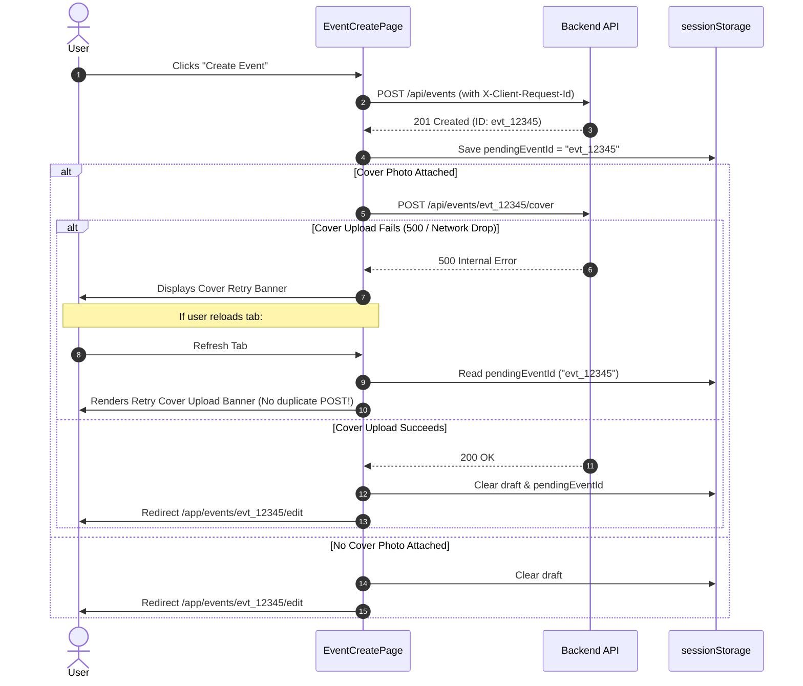

# 11 — Event Creation Idempotency and Partial Success

**Phase:** `11.1`  
**Defect Resolved:** `D11.1-02` (Duplicate Event Creation on Refresh after Cover Upload Failure)  
**Test Suite:** [Phase11_1DraftLifecycle.test.jsx](file:///d:/Koupreng-invitation_project/apps/frontend-user/src/features/events/onboarding/Phase11_1DraftLifecycle.test.jsx) (TC-RACE-02)

---

## 1. Two-Phase Creation Architecture

Event creation is a two-step network process:
1. **Phase 1: Event Creation:** `POST /api/events` (JSON payload)
2. **Phase 2: Cover Photo Upload:** `POST /api/events/:id/cover` (Multipart binary)

---

## 2. Vulnerability Analysis & Fix (D11.1-02)

In the initial implementation, `pendingEventId` was stored only in component memory state (`useState(null)`). If Phase 1 succeeded but Phase 2 failed, refreshing the browser caused the component to lose `pendingEventId`. Clicking "Create Event" again triggered another `POST /api/events`, creating a duplicate orphaned event in the database!

**The Fix:**
- `pendingEventId` is stored in `sessionStorage` under `koupreng_pending_event_<userId>`.
- On component mount, if `pendingEventId` exists, the wizard recognizes that the event is already created. It renders a dedicated recovery banner allowing the user to retry the photo upload or navigate straight to the event dashboard, with zero duplicate events created.
