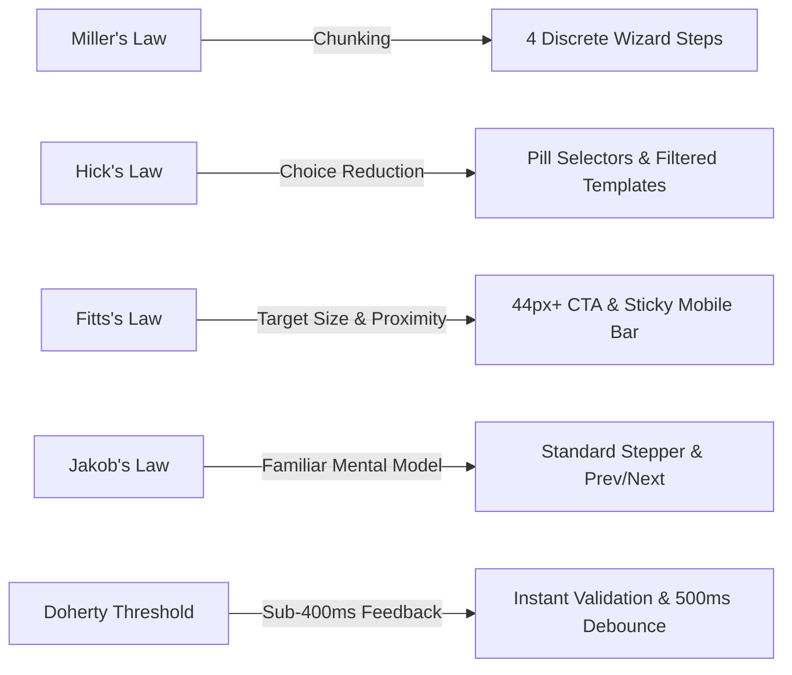

# 18 — Popular UX Laws Applied to Real Interactions

**Phase:** `11.1`  
**Traceability Evidence:** [ux-law-traceability.json](file:///d:/Koupreng-invitation_project/docs/uxui/phase11-1-gemini-event-creation-2026-11-19/evidence/ux-law-traceability.json)

---

## 1. UX Laws Mapping

1. **Miller’s Law (Chunking):**
   - The event creation process requires over 15 distinct data points. Presenting them as a single monolithic page induces cognitive overload. Splitting the flow into 4 distinct chunks (Type -> Media -> Template -> Review) keeps working memory within the 7 ± 2 item limit.
2. **Hick’s Law (Decision Time):**
   - In Step 1, rather than presenting a complex dropdown of 20 categories, 6 prominent event pills simplify initial decision time to under 2 seconds.
3. **Fitts’s Law (Touch Targets):**
   - Primary action buttons ("Next", "Create Event") are styled with generous 48px height and pinned to the bottom of the viewport on mobile devices, minimizing travel distance for the user's thumb.
4. **Jakob’s Law (Familiarity):**
   - Wizard follows established conventions: "Back" on the left, "Next" on the right, breadcrumb stepper at the top, and instant validation indicators.
5. **Doherty Threshold (< 400ms Response):**
   - Client-side validation triggers instantaneously (< 50ms) upon input change or step advancement, providing immediate reassurance.
