# 02 — Architecture Boundaries

> **Phase:** 12.1 (Wave 3 — Creator Experience & Event Operations)  
> **Topic:** Strict Clean Architecture Boundaries, Backend Immobility, and Frontend Encapsulation  
> **Status:** Complete in local working tree  
> **Artifact Directory:** [docs/uxui/phase12-1-gemini-owner-dashboard-2026-11-19/](file:///d:/Koupreng-invitation_project/docs/uxui/phase12-1-gemini-owner-dashboard-2026-11-19/)

---

## 1. Clean Architecture Boundaries

Phase 12.1 is strictly scoped to frontend user experience, state management, and visual components within `apps/frontend-user/`.

```mermaid
flowchart TD
    subgraph FrontendUser ["apps/frontend-user/src"]
        EventsFeature["features/events/EventsFeature.jsx"]
        EventCard["features/events/components/EventCard.jsx"]
        EventCalendar["features/events/components/EventCalendar.jsx"]
        EventWorkspace["features/events/workspace/EventWorkspace.jsx"]
        DashboardFeature["features/dashboard/DashboardFeature.jsx"]
        
        LocalStore[("localStorage / weddingStorage")]
        EventsFeature --> LocalStore
    end

    subgraph BackendAPI ["Spring Boot REST APIs (READ-ONLY)"]
        InvMy["GET /api/v1/invitations/my"]
        InvDetail["GET /api/v1/invitations/:id"]
        InvAccess["GET /api/v1/invitations/:id/access"]
        ReportsDash["GET /api/v1/reports/invitations/:id/dashboard"]
        BudgetItems["GET /api/v1/budget/items"]
        Gifts["GET /api/v1/planning/gifts"]
    end

    EventsFeature -->|Read Events| InvMy
    EventWorkspace -->|Read Detail & Access| InvDetail
    EventWorkspace -->|Verify Permissions| InvAccess
    DashboardFeature -->|Fetch Real Metrics| ReportsDash
    DashboardFeature -->|Fetch Raw Expenses| BudgetItems
    DashboardFeature -->|Fetch Raw Gifts| Gifts
```

---

## 2. Backend Immobility & Migration Safety

1. **Zero Database Changes:** No Flyway migration files were created, modified, or renumbered. All 48 existing migrations (`V1__...` through `V48__...`) remain untouched.
2. **Zero Backend Controller / Service Alterations:** No Java files under `apps/backend/` or `services/` were touched.
3. **Read-Only API Contracts:** The frontend consumes existing, verified endpoints without altering request envelopes or expecting unreleased server features.
4. **Token Parity:** Checked via `node scripts/sync-design-tokens.cjs --check`; zero token drift between user and admin workspaces.

---

## 3. Frontend Component Encapsulation

All state mutations, filter synchronizations, and race mitigations are encapsulated in their respective feature boundaries:
- `EventsFeature.jsx` coordinates list filtering, pagination, search, and view mode switching.
- `EventCard.jsx` encapsulates card presentation, badge selection, and role-aware action routing.
- `EventCalendar.jsx` encapsulates date math, month transitions, leap-year calculations, and agenda sorting.
- `EventWorkspace.jsx` encapsulates module routing, access validation, and navigation drawers.
- `DashboardFeature.jsx` encapsulates truthful KPI presentation, countdown math, and currency separation.
