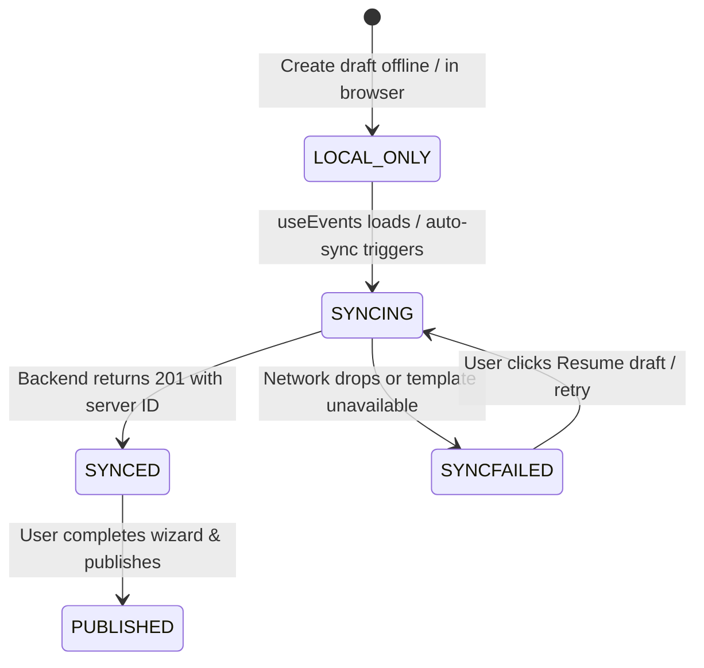

# 11 — Local Draft Lifecycle & Synchronization Truth

> **Phase:** 12.1 (Wave 3 — Creator Experience & Event Operations)  
> **Topic:** Offline Draft Retention, Background Sync, and Account Isolation  
> **Status:** Complete in local working tree  
> **Artifact Directory:** [docs/uxui/phase12-1-gemini-owner-dashboard-2026-11-19/](file:///d:/Koupreng-invitation_project/docs/uxui/phase12-1-gemini-owner-dashboard-2026-11-19/)

---

## 1. Lifecycle State Machine

---

## 2. Integrity Protections

1. **Never Destroy Unsynced Data:** If backend sync fails (e.g. 500 error or template unavailable), the local draft is retained in `localStorage` with `syncStatus: "SYNC_FAILED"` and the exact error message.
2. **No False Green:** A local-only draft is never labeled "Published" or "Cloud Synced" until a numeric server ID is returned by the API.
3. **Account Isolation:** `weddingStorage` indexes drafts by the active user's ID. When switching accounts from User A to User B, User A's drafts are not shown to User B.
4. **Resume Route Resolution:** Local drafts without numeric server IDs route to `/dashboard/invitations/:id/edit`, while server events route to `/app/events/:id`.
