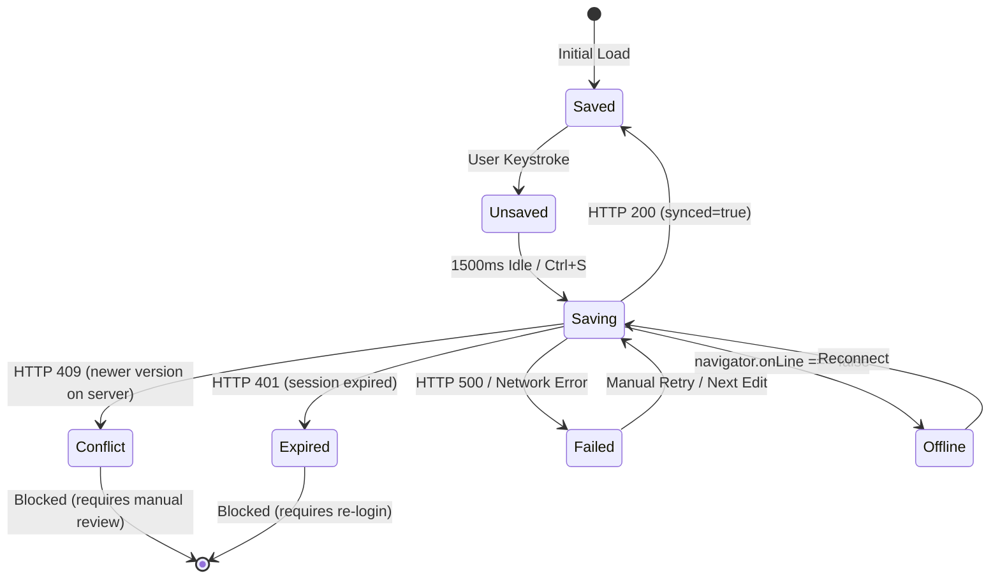

# Report 08: Auto-Save Persistence & Dirty State Lifecycle Audit

> **Target:** `useStudioPersistence.js` Lifecycle, Debouncing & Status Phases  
> **Auditor:** Codex (Senior Frontend Engineer)  
> **Date:** 2026-11-19T21:30:00+07:00

---

## 1. Autosave State Machine

The Studio persistence hook models the full lifecycle of an asynchronous distributed document editor:

---

## 2. Technical Contracts Verified

### 1. 1500ms Debounce
- Autosave triggers 1500ms after the last user keystroke.
- Every new input event clears the existing timeout and starts a new 1500ms window.
- In `InvitationStudioNegativeScenarios.test.jsx N13-32`, rapid keystroke bursts execute without network congestion; buffered state is saved accurately.

### 2. Concurrent Snapshot Isolation (N13-05)
- If the user types revision `v3` while revision `v2` is in-flight across the network, the successful return of `v2` does NOT mark the editor as clean/saved.
- `acknowledged.current` is set to `v2`, but because `latest.current.serialized` is `v3`, `dirty` remains `true` and `state.phase` switches to `unsaved`.
- A follow-up save is automatically scheduled for `v3`. This completely prevents stale acknowledgements!

### 3. Fail-Closed on 401/403/409 (N13-04)
- On HTTP 409 Conflict: phase is set to `conflict`, background timer is halted, and user edits remain in memory without being discarded.
- On HTTP 401 Unauthorized: phase is set to `expired`, writes are suspended, and user is instructed to preserve changes before logging in.
